<p align="center">
  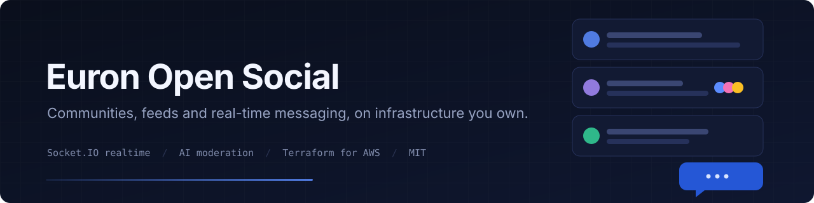
</p>

<p align="center">
  
  <a href="LICENSE"></a>
  
  
  
  
  
  
  
  
</p>

<p align="center">
  <a href="https://github.com/euron-sde-team/euron-open-social-network/stargazers"></a>
  <a href="https://github.com/euron-sde-team/euron-open-social-network/fork"></a>
  <a href="https://github.com/euron-sde-team/euron-open-social-network/watchers"></a>
  <br>
  <a href="https://github.com/euron-sde-team/euron-open-social-network/issues"></a>
  <a href="https://github.com/euron-sde-team/euron-open-social-network/pulls"></a>
  <a href="https://github.com/euron-sde-team/euron-open-social-network/commits/main"></a>
  
</p>

<p align="center">
  <b><a href="#-quickstart">Quickstart</a></b> ·
  <b><a href="#️-architecture">Architecture</a></b> ·
  <b><a href="#-explore-the-repository">Explore the repo</a></b> ·
  <b><a href="docs/api/openapi.yaml">API reference</a></b> ·
  <b><a href="#️-deploy-to-aws">Deploy</a></b> ·
  <b><a href="docs/architecture/security.md">Security</a></b> ·
  <b><a href="#-documentation">Docs</a></b>
</p>

**Euron Open Social** is an open-source, MIT-licensed social network for organisations and
communities that want their conversations on infrastructure they own. It is part of the
open-source initiative of **ENGAGESPHERE TECHNOLOGY PRIVATE LIMITED**.

People join communities (public or private, created by anyone you allow), post to a familiar
feed with photos, polls and reactions, talk in community chat rooms and private messages,
organise events with RSVPs and waitlists, and ask questions that get accepted answers.
Moderators get an AI-assisted queue, user reports and an appeals process.

The rules that make a social network safe are enforced by the server, not left to the UI:

- You can only message people you share a community with, and a first message arrives as a request.
- A block hides both people from each other everywhere: feed, comments, search, profiles, messages, presence.
- Private community content never leaves the community, on any endpoint or socket.

Everything runs on a laptop against an AWS emulator, and deploys to AWS with one command
from the same Terraform.

<p align="center">
  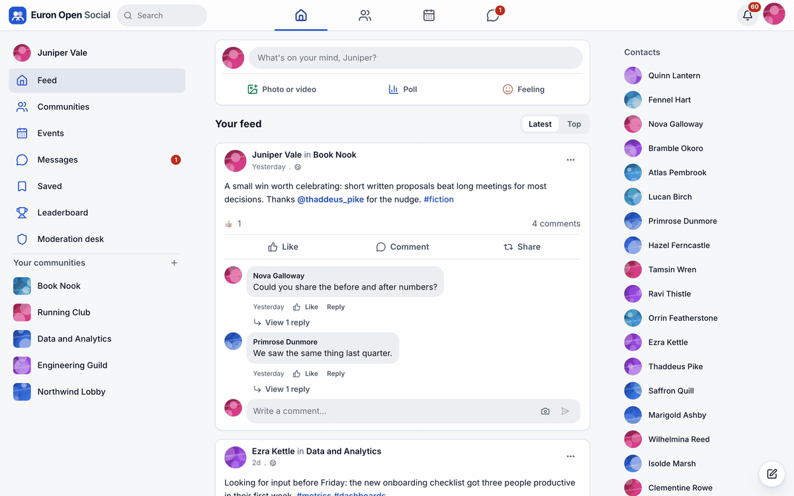
</p>

> [!NOTE]
> Everything in the tour ran for real: Docker Compose on a laptop, with S3, SES, KMS and
> Secrets Manager emulated locally and provisioned by the same Terraform modules that build
> production. `make up && make demo` reproduces it.

---

## 📚 Table of contents

- [Why Euron Open Social](#-why-euron-open-social)
- [At a glance](#-at-a-glance)
- [Screenshots](#️-screenshots)
- [Features](#-features)
- [Architecture](#️-architecture)
  - [A message, from send to screen](#a-message-from-send-to-screen)
  - [Who may message whom](#who-may-message-whom)
  - [Moderation](#moderation)
  - [Media](#media)
- [Tech stack](#-tech-stack)
- [Prerequisites](#-prerequisites)
- [Quickstart](#-quickstart)
- [Explore the repository](#-explore-the-repository)
- [API](#-api)
- [Configuration](#️-configuration)
- [Deploy to AWS](#️-deploy-to-aws)
- [Security model](#-security-model)
- [Testing](#-testing)
- [Documentation](#-documentation)
- [Roadmap](#️-roadmap)
- [FAQ](#-faq)
- [Contributing, security and license](#-contributing-security-and-license)

---

## 💡 Why Euron Open Social

Most organisations run their community on someone else's platform: the members, the
conversations and the moderation decisions all live in a product they cannot inspect or
move. Building your own sounds simple until you meet the hard parts: realtime delivery
across servers, private spaces that must not leak, blocking that actually works, media that
carries GPS coordinates, and a moderation workflow people can trust.

Euron Open Social is those hard parts, done and tested:

- **A feed people already know how to use.** Three-column layout, post cards, seven
  reactions, threaded comments, a messenger dock. No training needed.
- **Safety rules in the data layer.** Blocks and private-community visibility are applied
  by shared SQL expressions in every query, and integration tests sweep every endpoint.
- **Realtime that scales out.** Socket.IO with a Redis adapter: add API servers and every
  user still receives their messages, typing indicators and notifications.
- **Moderation that is fair.** Classifiers triage, people decide. Every decision is logged,
  authors are told why, and appeals go to a different moderator.
- **Production-grade on AWS in one command.** VPC, RDS, ElastiCache, S3 with KMS, SES,
  ECS Fargate, CloudFront with WAF, alarms. The same modules provision the local emulator.

## 📊 At a glance

| | |
|---|---|
| **Apps** | Web app (Next.js), API with the Socket.IO gateway, background worker |
| **Social** | Feed, communities (public and private, user-created), posts, comments, reactions, polls, Q&A, events, profiles, follows, blocks, search, points and leaderboard |
| **Messaging** | Direct and group messages with requests, community chat rooms, typing, read receipts, presence |
| **Safety** | Shared-community message rule, two-way blocks, AI-assisted moderation (OpenAI, keyword rules, or a test stub), reports, appeals, audit log |
| **Infrastructure** | 13 Terraform modules, 3 environments (local emulator, AWS dev, AWS prod) |
| **Tests** | 353 unit, 255 integration (run under 12 backend combinations), 14 browser end-to-end |
| **License** | MIT |

## 🖼️ Screenshots

<table>
  <tr>
    <td width="50%">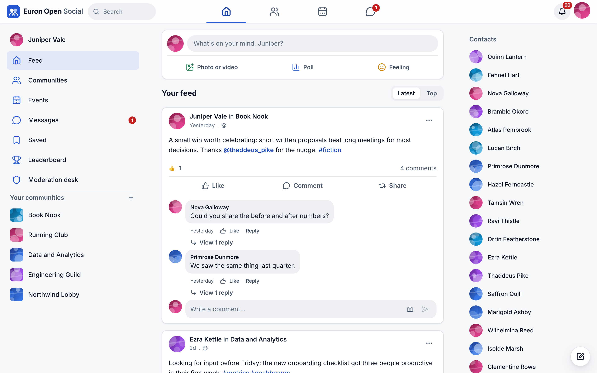<br><sub><b>Feed.</b> Your communities and the people you follow, with live new-post signals.</sub></td>
    <td width="50%">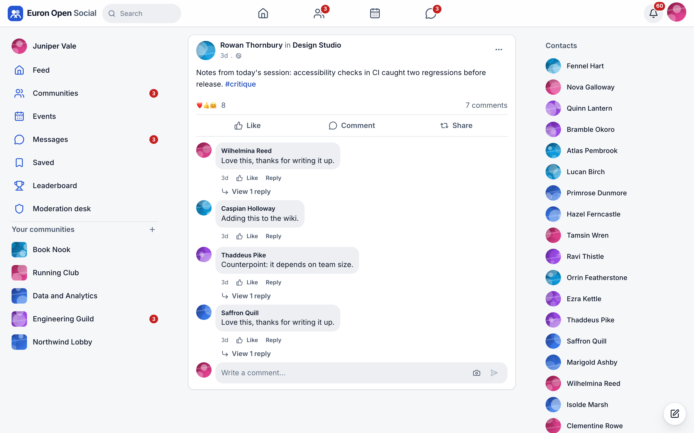<br><sub><b>Post.</b> Seven reactions, threaded replies, mentions and tags, live counts.</sub></td>
  </tr>
  <tr>
    <td>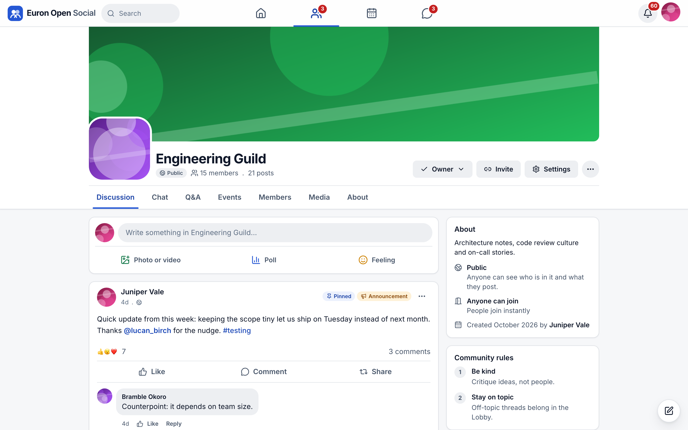<br><sub><b>Community.</b> Discussion, chat, Q&A, events, members, media and rules in one place.</sub></td>
    <td>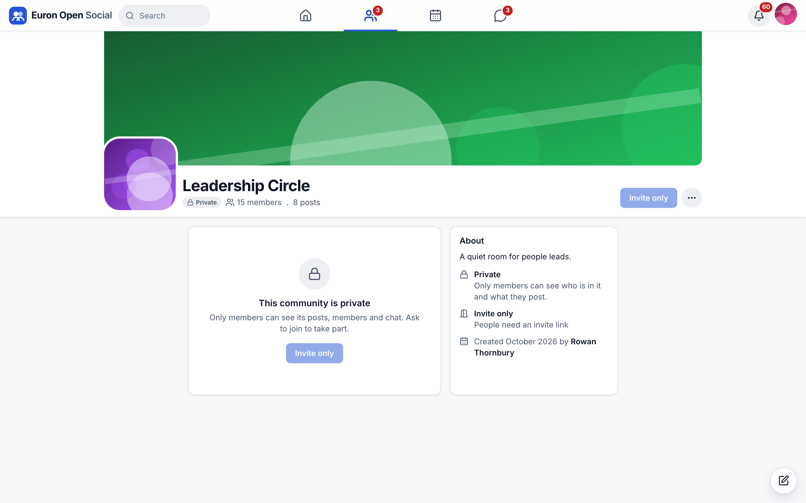<br><sub><b>Private communities.</b> Non-members see the card, never the content.</sub></td>
  </tr>
  <tr>
    <td>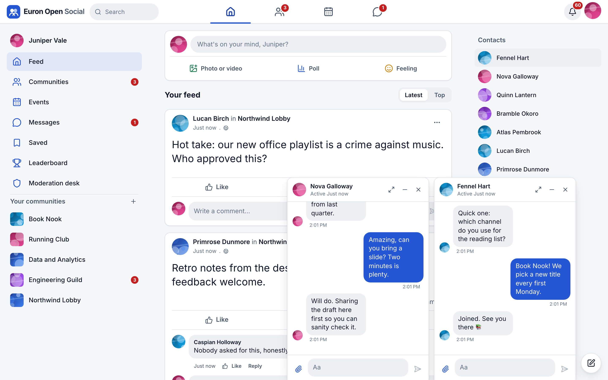<br><sub><b>Messenger dock.</b> Conversations follow you around the app.</sub></td>
    <td>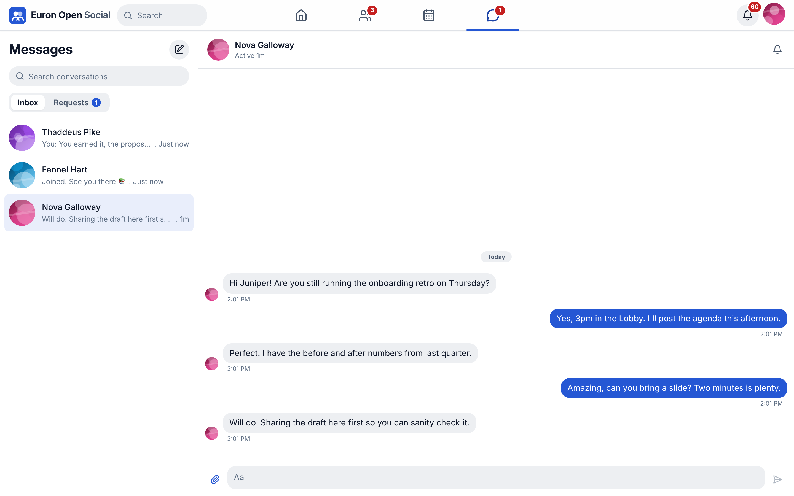<br><sub><b>Messages.</b> Inbox and message requests, read receipts, typing indicators.</sub></td>
  </tr>
  <tr>
    <td>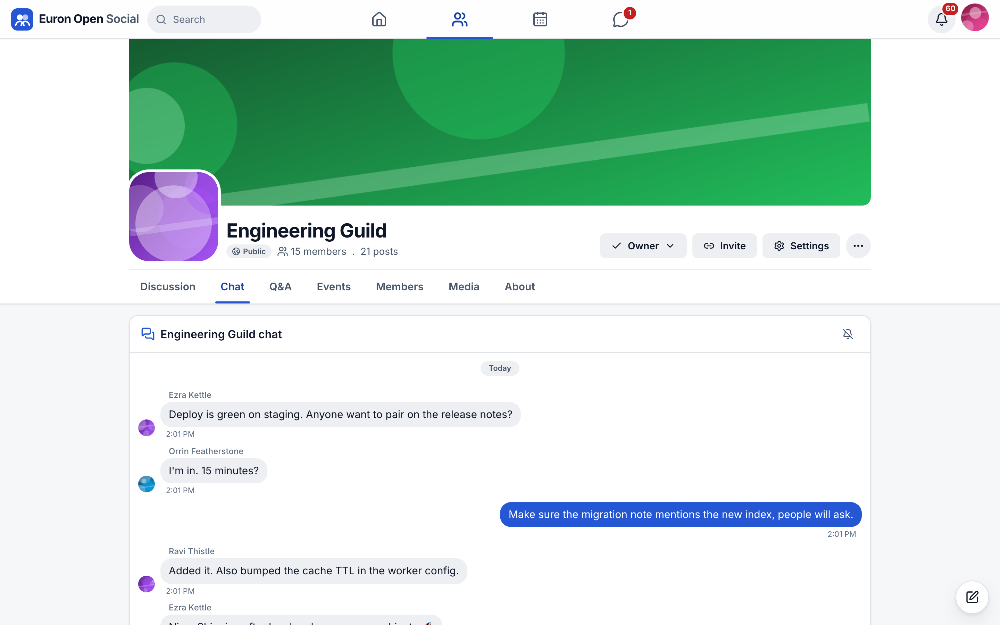<br><sub><b>Community chat.</b> A live room for every community, members only.</sub></td>
    <td>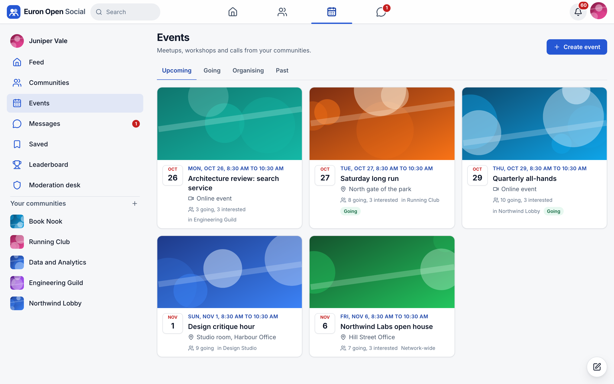<br><sub><b>Events.</b> RSVPs with capacity, an automatic waitlist and reminders.</sub></td>
  </tr>
  <tr>
    <td>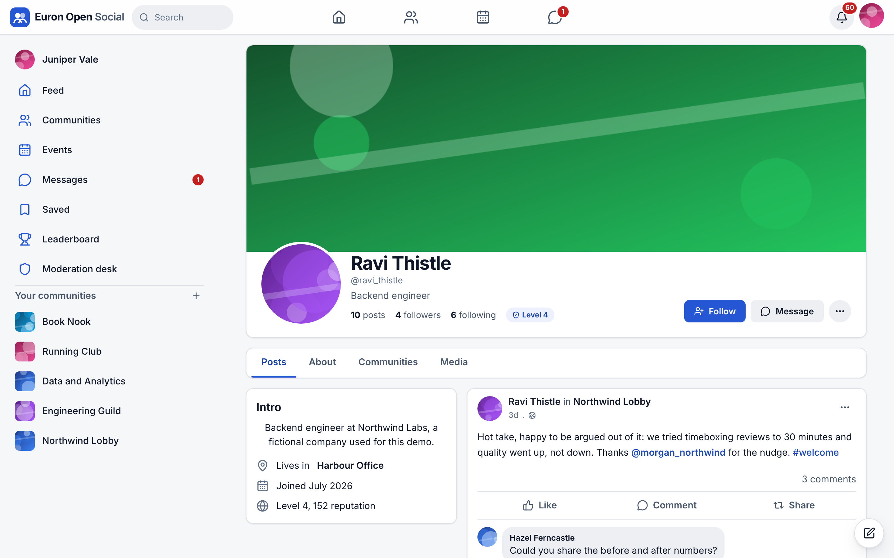<br><sub><b>Profiles.</b> Cover photo, reputation level, follow, message, block.</sub></td>
    <td>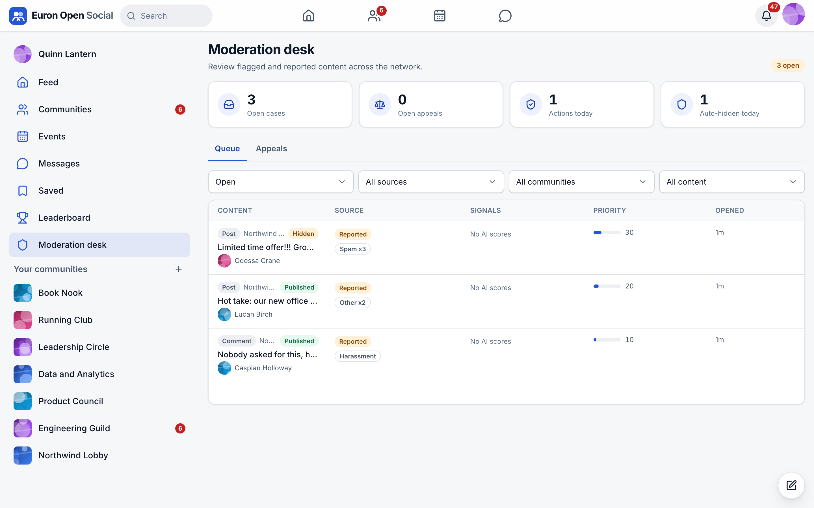<br><sub><b>Moderation desk.</b> Reports and AI signals in one queue, ranked by priority.</sub></td>
  </tr>
  <tr>
    <td>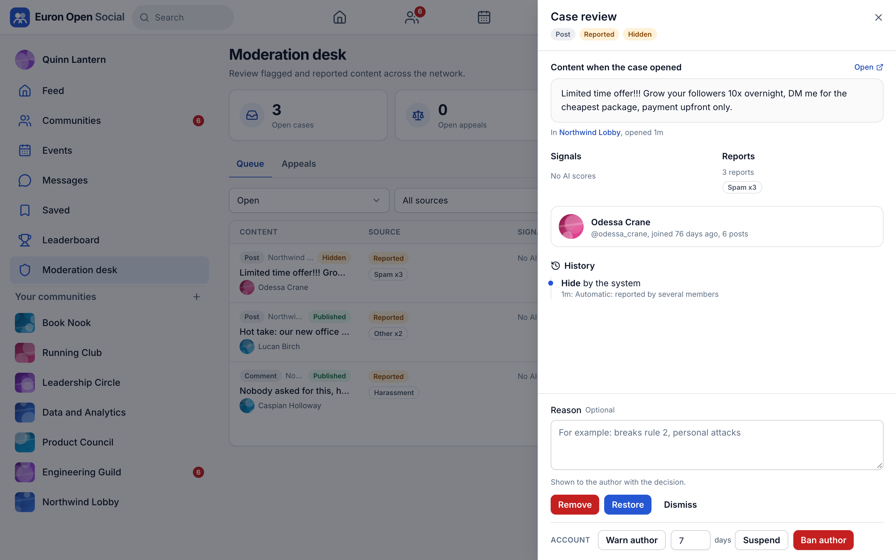<br><sub><b>Case review.</b> The content as reported, its history, and every action a moderator can take.</sub></td>
    <td>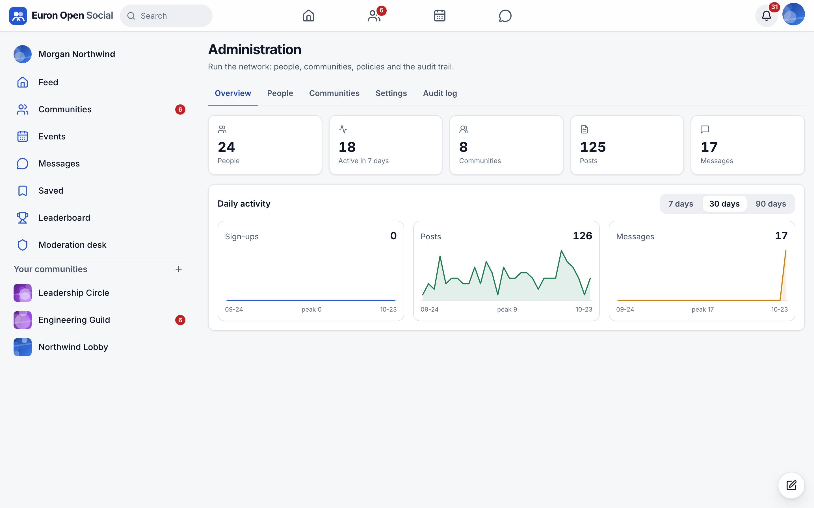<br><sub><b>Administration.</b> Network totals, activity, people, communities, settings and the audit log.</sub></td>
  </tr>
  <tr>
    <td>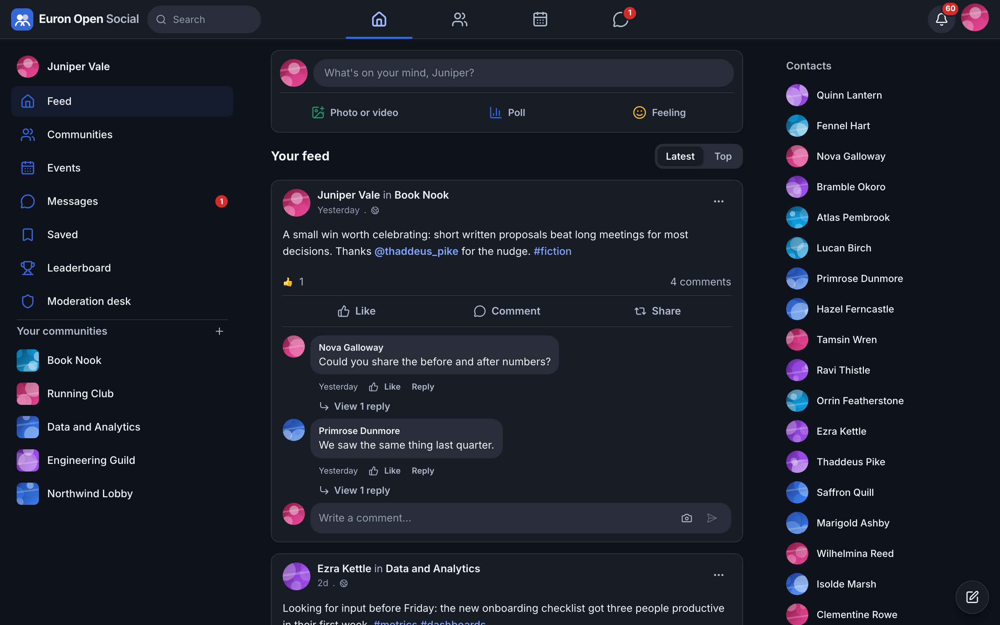<br><sub><b>Dark mode.</b> Every screen, following the system setting or your choice.</sub></td>
    <td>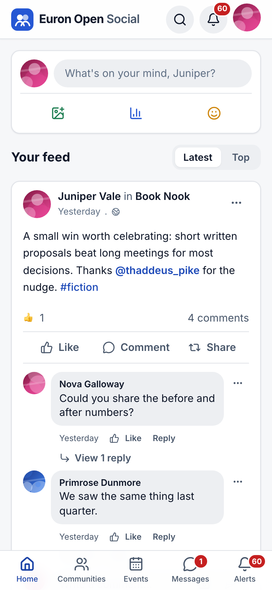<br><sub><b>Mobile.</b> Responsive down to phone width, with a bottom navigation bar.</sub></td>
  </tr>
</table>

## ✨ Features

| Area | What you get |
|---|---|
| **Feed** | Latest and Top feeds from your communities and the people you follow, a "new posts" pill fed by the socket, photo and video posts with a mosaic and lightbox, polls, feelings, tags and mentions, reshares, bookmarks, "hide from my feed" |
| **Reactions and comments** | Like plus six reactions with a long-press picker, threaded comments with mentions and an image, live counts on an open post |
| **Communities** | Anyone can create one (or only staff, by setting): public or private, open, approval or invite-only, rules, roles (owner, admin, moderator, member), invite links with limits, suspensions and bans, optional pre-moderation |
| **Messaging** | Direct and group threads, message requests, accept and decline, replies, reactions, pins, edits, attachments, typing indicators, "Seen" receipts, mute, a messenger dock on every page |
| **Community chat** | A live room per community with replies, reactions, pins and moderator controls |
| **Events** | Community or network-wide events, virtual or in person, capacity with an automatic waitlist, RSVP, reminders, calendar download |
| **Q&A** | Questions with votes, answers, and an accepted answer chosen by the asker |
| **People** | Profiles with cover photos, follows, blocks, presence, reputation points and levels, a leaderboard |
| **Moderation** | Scans of posts, comments, chat, messages, Q&A, events and profiles; per-category thresholds; review queue; report reasons; approve, hide, remove, restore, warn, suspend, ban; appeals; full history |
| **Accounts** | Email verification, password reset, two-factor sign-in with recovery codes, session list with sign-out, data export, account deletion, digest emails |
| **Administration** | Network settings, moderation thresholds and blocked terms, users, communities, audit log, activity charts |

## 🏗️ Architecture

<p align="center">
  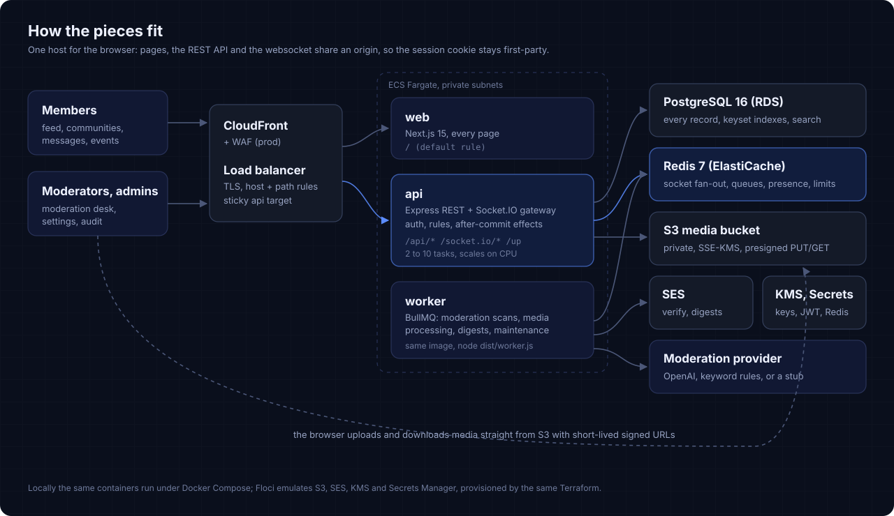
</p>

- **One origin for the browser.** The load balancer routes `/api/*`, `/socket.io/*` and
  `/up` to the API and everything else to the web app, so the session cookie is first-party
  and there is no CORS in production.
- **Stateless servers.** API tasks keep nothing in memory that matters: sockets fan out
  through Redis, rate limits live in Redis, sessions live in Postgres.
- **The worker does the slow work.** Moderation scans, image processing, digest emails and
  maintenance run on BullMQ queues in a separate service built from the same image.
- **Side effects only after commit.** Socket emits, jobs and notifications are collected
  during a transaction and released only when it commits
  ([`core/effects.ts`](apps/api/src/core/effects.ts)), so nobody is ever told about a
  message that rolled back.

### A message, from send to screen

<p align="center">
  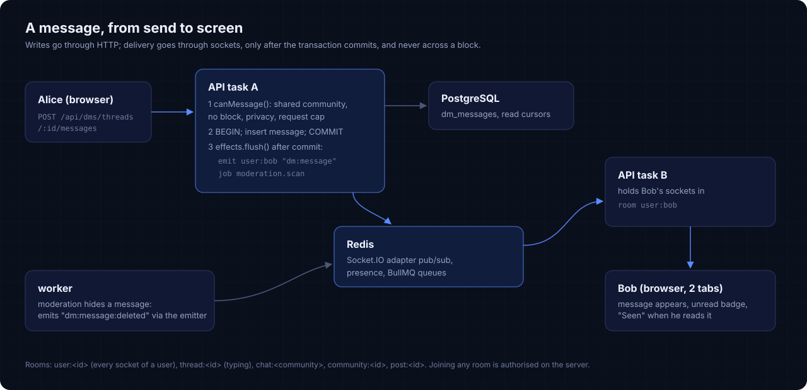
</p>

Every socket joins a room for its user. A message is delivered by emitting to the
recipient's room, so it reaches every tab and device, whichever API server holds them.
Joining any other room (a community chat, an open post, a thread) is authorised by the
server, and leaving a community, being banned or blocking someone removes the sockets
from the rooms they no longer belong in.

### Who may message whom

The rule lives in one pure function, [`domain/dm-eligibility.ts`](apps/api/src/domain/dm-eligibility.ts),
checked in this order:

1. You cannot message yourself, and restricted accounts cannot start conversations.
2. A block in either direction stops everything, staff included.
3. Staff may message anyone for support.
4. The recipient's privacy setting: nobody, people they follow, or members of a shared community (the default).
5. You must share at least one community where you are both active members.

A first message from someone the recipient does not follow arrives as a **message request**
(at most three messages until it is accepted). Declining is quiet: the sender only learns
that the person is not accepting messages.

### Moderation

<p align="center">
  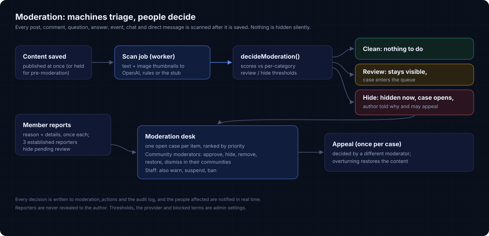
</p>

The provider is pluggable: OpenAI's moderation model (text and images), a zero-config
keyword and spam rules engine, or a stub server for tests. Thresholds per category are
admin settings, and the policy that turns scores into an outcome is a pure, unit-tested
function ([`domain/moderation-decision.ts`](apps/api/src/domain/moderation-decision.ts)).
Community moderators handle content in their communities; account actions (warn, suspend,
ban) are for platform staff.

### Media

<p align="center">
  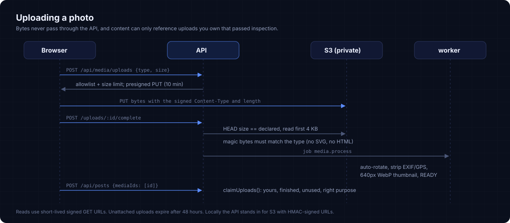
</p>

Bytes never pass through the API. The bucket is private and encrypted with KMS, every read
is a short-lived signed URL, and content can only reference uploads by id: yours, finished,
inspected and unused. Photos are shown only after location and camera metadata are stripped.

## 🧰 Tech stack

| Layer | Choice |
|---|---|
| Web | Next.js 15 (App Router), React 19, TanStack Query, Radix UI, Tailwind CSS |
| API | Node.js 22, Express 5, Kysely on PostgreSQL 16, zod, Socket.IO 4 with the Redis adapter |
| Jobs | BullMQ on Redis 7 |
| Media | S3 presigned uploads, sharp for image processing |
| Mail | Amazon SES (or SMTP, or a local outbox) |
| Moderation | OpenAI omni-moderation, a rules engine, or a stub (pluggable) |
| Infrastructure | Terraform, ECS Fargate, ALB, CloudFront and WAF, RDS, ElastiCache, S3, KMS, SES, Secrets Manager, CloudWatch |
| Local AWS | The Floci emulator (S3, SES, KMS, Secrets Manager) and Mailpit ([ADR 0013](docs/architecture/adr/0013-floci-for-local-aws.md)) |
| Tooling | pnpm workspaces, Turborepo, TypeScript strict, Vitest, Playwright, ESLint, Prettier |

## 📋 Prerequisites

- Docker with Compose v2 (about 6 GB of free disk for images)
- Node.js 22 and pnpm 9 (only to run tests or develop outside Docker)
- For AWS: an account, a domain in Route 53 with an ACM certificate, and Terraform 1.10 or later

No AWS account is needed to run it locally.

## 🚀 Quickstart

```bash
git clone https://github.com/euron-sde-team/euron-open-social-network.git
cd euron-open-social-network
make up      # builds the images, starts Floci, Postgres, Redis, Mailpit and the app
make demo   # seeds "Northwind Labs": users, communities, posts, events, messages
```

| What | Where |
|---|---|
| The app | http://localhost:3510 |
| Mail (verification links, digests) | http://localhost:8026 |
| API readiness | http://localhost:5006/api/ready |

`make demo` prints the demo accounts (an admin, a moderator and members) and their shared
password. Sign up with any address to see the email flow: the verification mail lands in
Mailpit. `make down` stops everything and deletes the local data.

The full walkthrough, including ports and how to reset, is in
[docs/guides/quickstart-local.md](docs/guides/quickstart-local.md).

## 🧭 Explore the repository

```
apps/
  api/              Express API, Socket.IO gateway, BullMQ worker, CLI
    src/routes/         URL + guards, one line per endpoint
    src/controllers/    parse the request (zod), call one service, respond
    src/services/       business rules, transactions, after-commit effects
    src/repositories/   every SQL query; visibility.ts applies blocks and privacy
    src/presenters/     rows to API shapes, batched, signed media URLs
    src/domain/         pure rules: message eligibility, moderation decisions, ranking, media types
    src/realtime/       the gateway, presence, the transport port
    src/jobs/           queue handlers and maintenance
  web/              Next.js app: feed, communities, messenger, events, moderation desk, admin
  moderation-stub/  OpenAI-compatible fake moderation server for tests
packages/
  types/            the API contract: response shapes and the socket event map
  api-client/       typed client with token refresh, uploads and the socket
  ui/               design system: tokens, light and dark, Radix components
db/migrations/      the schema (SQL), applied by a checksummed runner
infra/terraform/    13 modules and 3 environments; infra/docker: the images
deploy/compose/     the local stack (Floci overlay, real-AWS overlay)
e2e/                Playwright suites against the full stack
docs/               architecture, ADRs, guides, the API reference
```

Start reading at [docs/guides/walkthrough.md](docs/guides/walkthrough.md): it follows one
new member from joining a community to a moderation case, naming the file at every step.

## 🔌 API

REST under `/api` and Socket.IO under `/socket.io`, on the same origin as the web app.

- [docs/api/rest-contract.md](docs/api/rest-contract.md): every endpoint, its access level, body and response.
- [docs/api/openapi.yaml](docs/api/openapi.yaml): the OpenAPI 3.1 reference, generated from the route files (`make openapi`).
- [docs/architecture/realtime.md](docs/architecture/realtime.md): socket events, rooms and delivery guarantees.

```bash
# sign in, then call the API with the access token
TOKEN=$(curl -s localhost:5006/api/auth/login -H 'content-type: application/json' \
  -d '{"login":"admin@example.com","password":"<demo password>"}' | jq -r .accessToken)
curl -s localhost:5006/api/posts/feed -H "authorization: Bearer $TOKEN" | jq '.items[0].body'
```

## ⚙️ Configuration

Every environment variable is declared and validated in one place,
[`apps/api/src/core/config.ts`](apps/api/src/core/config.ts), and documented in
[docs/guides/configuration.md](docs/guides/configuration.md). In production the API refuses
to start with a development secret, an open CORS policy, local storage, an outbox mailer or a
placeholder API key.

Network-level policy (who may create communities, registration mode, moderation thresholds,
blocked terms) is changed by admins in the app, not in environment variables.

## ☁️ Deploy to AWS

```bash
cd infra/terraform/envs/aws-dev
cp terraform.tfvars.example terraform.tfvars    # name_prefix, domain, route53 zone, certificate
cd -
make aws-deploy ENV=aws-dev                     # registries, images, infrastructure, migrations, rollout
make aws-admin ENV=aws-dev EMAIL=you@example.com   # emails you a link to set the admin password
```

`aws-deploy` builds and pushes both images, applies the Terraform, runs the migrations as a
one-off task and waits for the services to be stable. `aws-dev` is sized small (one NAT
gateway, single-node Redis, no CDN); `aws-prod` adds three availability zones, Multi-AZ
database and cache, CloudFront with WAF, autoscaling and deletion protection.

Read [docs/guides/deploy-aws.md](docs/guides/deploy-aws.md) before the first deploy: it
covers SES production access, sizing, updates, rollbacks and teardown.

## 🔐 Security model

- **Sessions:** short-lived access tokens kept only in memory; refresh tokens in an httpOnly
  cookie, rotated on every use, with reuse detection that revokes the whole session family.
- **Accounts:** email verification, two-factor sign-in with encrypted secrets and recovery
  codes, throttled sign-in that never reveals whether an account exists.
- **Authorisation:** blocks and private-community visibility applied in SQL by shared helpers;
  suspended members lose posting and moderation rights; moderators cannot judge their own content.
- **Realtime:** every room join is authorised; bans and sign-outs disconnect sockets at once.
- **Media:** type allowlist, magic-byte checks, metadata stripping, private bucket, signed URLs.
- **Infrastructure:** private subnets, KMS everywhere, TLS-only bucket, Redis with TLS and a
  password, least-privilege task roles, WAF, and a CloudFront origin secret the load balancer checks.

Details, and an honest list of known limitations, are in
[docs/architecture/security.md](docs/architecture/security.md) and the
[threat model](docs/architecture/threat-model.md). To report a vulnerability, see
[SECURITY.md](SECURITY.md).

## 🧪 Testing

| Suite | What it proves | Run |
|---|---|---|
| Unit (353) | Message eligibility, moderation decisions, ranking, media sniffing, cursors, the web app's state logic and components | `make test` |
| Integration (255) | The real API and socket gateway in-process against Postgres and Redis: every endpoint, block and privacy sweeps, realtime delivery across two servers, moderation with the stub | `make test-integration` |
| Matrix (12 runs) | The integration suite under every backend: local or S3 storage, outbox, SMTP or SES mail, rules or stub moderation | `make test-matrix` |
| Browser (14) | Sign-up by email, posting with a photo, live reactions, private communities, message requests, blocking, moderation and appeals, events, two-factor | `make e2e` |
| Infrastructure | `terraform validate` for three environments, tflint, checkov, shellcheck, gitleaks | `make tf-validate tf-lint tf-security` |

How to run each suite, and what the matrix covers, is in [docs/guides/testing.md](docs/guides/testing.md).

## 📖 Documentation

| Architecture | Guides |
|---|---|
| [High-level design](docs/architecture/HLD.md) | [Quickstart (local)](docs/guides/quickstart-local.md) |
| [Low-level design](docs/architecture/LLD.md) | [Local with real AWS](docs/guides/local-with-aws.md) |
| [Data model](docs/architecture/data-model.md) | [Deploy to AWS](docs/guides/deploy-aws.md) |
| [Realtime](docs/architecture/realtime.md) | [Configuration](docs/guides/configuration.md) |
| [Moderation](docs/architecture/moderation.md) | [Operations](docs/guides/operations.md) |
| [Media](docs/architecture/media.md) | [Moderation playbook](docs/guides/moderation-playbook.md) |
| [Security](docs/architecture/security.md) | [Troubleshooting](docs/guides/troubleshooting.md) |
| [Threat model](docs/architecture/threat-model.md) | [Testing](docs/guides/testing.md) |
| [Decision records (13)](docs/architecture/adr/README.md) | [Walkthrough: one member, end to end](docs/guides/walkthrough.md) |

## 🗺️ Roadmap

- Web push and mobile notifications
- Link previews with a sandboxed fetcher
- Video transcoding for adaptive playback
- Single sign-on (OIDC and SAML) for organisations
- Full-text search on a dedicated engine for very large networks
- Federation (ActivityPub) as an option for public communities

Ideas and pull requests are welcome: open an issue to discuss larger changes first.

## ❓ FAQ

<details>
<summary><b>Is it multi-tenant?</b></summary>

No: one deployment is one network, like Mastodon or Discourse. Organisations run their own.
The reasoning is in [ADR 0001](docs/architecture/adr/0001-single-network-per-deployment.md).
</details>

<details>
<summary><b>Do I need an OpenAI key?</b></summary>

No. Without one, moderation uses the built-in keyword and spam rules, and everything else
works the same. With a key, posts, comments, messages and images are also classified by
OpenAI's moderation model, and the thresholds decide what is queued or hidden.
</details>

<details>
<summary><b>Why can't people message anyone they like?</b></summary>

Unsolicited messages are the main abuse vector in social products. Requiring a shared
community, plus message requests for first contact, keeps messaging useful without opening
every inbox to strangers. Staff can always reach members for support.
</details>

<details>
<summary><b>How does it scale?</b></summary>

Add API tasks: sockets fan out through Redis, so any server can deliver to any user. Lists
use keyset pagination (no OFFSET, no counts), search uses Postgres full-text and trigram
indexes, and slow work runs on the worker. The production environment autoscales the API,
worker and web services independently.
</details>

<details>
<summary><b>Can I run it without Docker or without AWS?</b></summary>

Yes. The API needs Postgres and Redis; storage can be local disk, mail can be SMTP or an
outbox, and moderation can run on rules. `make up` is simply the fastest way to see
everything, including the AWS services, working together.
</details>

<details>
<summary><b>Is the demo data real?</b></summary>

No. "Northwind Labs" and its people are fictional, the addresses use example.com, and every
image is generated by code.
</details>

## 🤝 Contributing, security and license

- Contributions: read [CONTRIBUTING.md](CONTRIBUTING.md) and the
  [code of conduct](CODE_OF_CONDUCT.md).
- Security issues: please report privately, as described in [SECURITY.md](SECURITY.md).
- License: [MIT](LICENSE).

Released under the [MIT License](LICENSE). Copyright (c) 2026 ENGAGESPHERE TECHNOLOGY
PRIVATE LIMITED and the Euron Open Social contributors.

<p align="center">
  <sub>If Euron Open Social is useful to you, <a href="https://github.com/euron-sde-team/euron-open-social-network/stargazers">star the repository</a>: it helps others find it.</sub>
</p>
