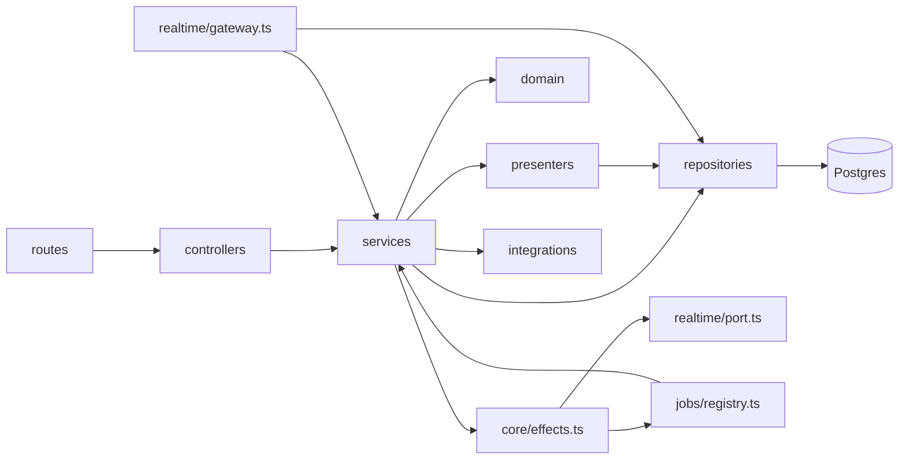
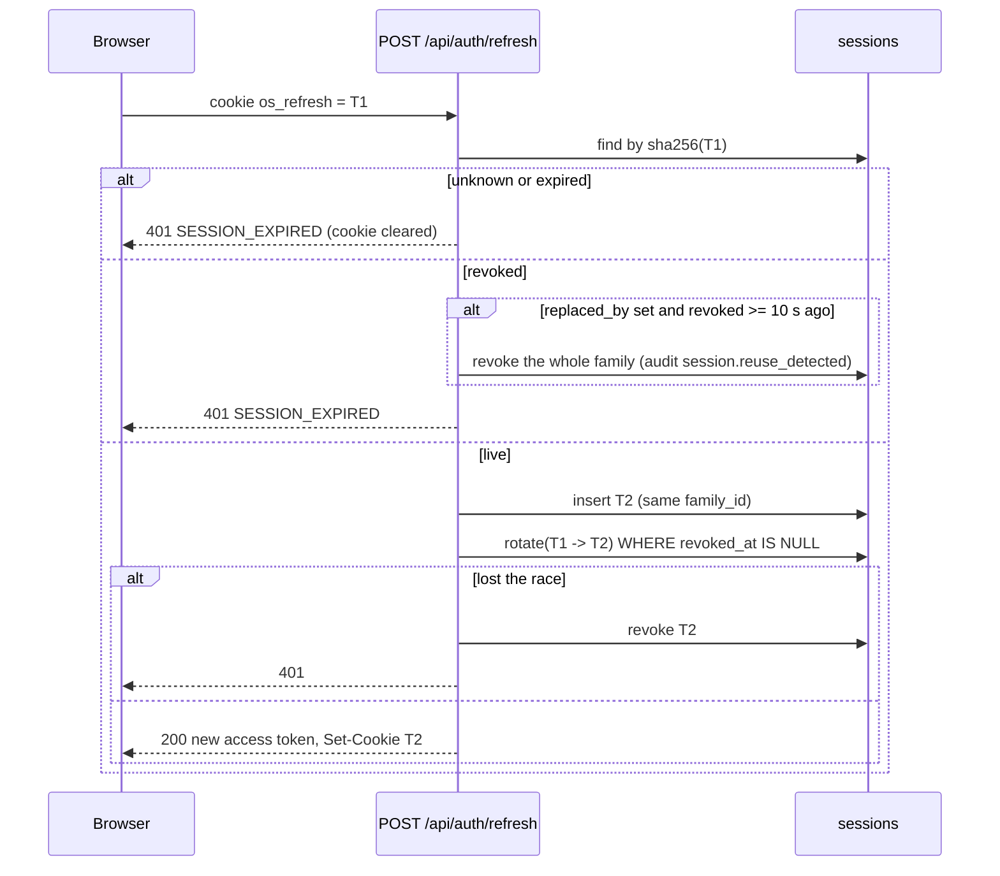
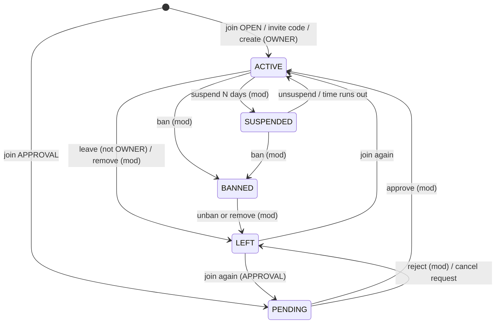

# Low-level design

How the API is built, layer by layer and module by module. The [HLD](HLD.md) covers the
system around it; [realtime.md](realtime.md), [moderation.md](moderation.md) and
[media.md](media.md) go deeper on those three subsystems. Paths are relative to
`apps/api/src/` unless they start with a repository folder (`db/`, `packages/`, `infra/`).

## 1. Layout

```
src/
  index.ts  worker.ts  cli.ts  app.ts      entry points and the Express factory
  core/            config, errors, ids, cursor, effects, context (Actor), logger, validate, aws, data-dir
  db/              kysely.ts (the pool), connection-config.ts, types.ts (generated)
  routes/          one router per area, mounted in routes/index.ts
  middleware/      auth.ts, rate-limit.ts, http.ts (actorOf, meta)
  controllers/     parse input with zod, call one service function, send JSON
  services/        business rules, transactions, effects; moderation/ has its own folder
  repositories/    every SQL statement, plus visibility.ts, keyset.ts, text-search.ts
  presenters/      rows to DTOs, batched; sign media URLs
  domain/          pure rules: access, DM eligibility, ranking, RSVP, media rules, thresholds
  integrations/    redis.ts, storage.ts (S3 / local), mail/ (mailer, templates)
  realtime/        port.ts (rooms + transport), gateway.ts, emitter.ts, presence.ts
  jobs/            registry.ts (queues), index.ts, *.jobs.ts handlers
  security/        passwords.ts, tokens.ts, totp.ts
  demo/seed.ts     the demo network
```



Rules the layers keep ([ADR 0003](adr/0003-layered-repository-pattern.md)):

- **Routes** declare the path, the auth middleware and rate limits, nothing else. They are
  also the input to `scripts/gen-openapi.ts`, which regenerates
  [`docs/api/openapi.yaml`](../api/openapi.yaml) (`make openapi`; CI runs `pnpm openapi --check`).
- **Controllers** never contain rules. They parse `req.body`, `req.query` and `req.params`
  with zod and pass an `Actor` (not the request) to the service.
- **Services** take an `Actor` ([`core/context.ts`](../../apps/api/src/core/context.ts)), so the
  same function serves HTTP, sockets, jobs, the CLI, the demo seed and tests. They throw
  `HttpError`s and own transactions.
- **Repositories** hold the SQL. Every method takes an optional `Executor` (the pool or a
  transaction) as its last argument.
- **Presenters** turn rows into the DTOs of [`packages/types`](../../packages/types/src/index.ts),
  loading related rows in batches (one query per kind, never one per row).
- **Domain** modules are pure functions with unit tests in `apps/api/test/unit`.

## 2. Conventions, with the real code

**Configuration.** One zod schema parses `process.env` once
([`core/config.ts`](../../apps/api/src/core/config.ts)). `assertProductionConfig()` lists
insecure settings and throws when `NODE_ENV=production`. Every variable is documented in
[configuration.md](../guides/configuration.md).

**Identifiers.** ULIDs from a monotonic factory ([`core/ids.ts`](../../apps/api/src/core/ids.ts)),
stored as `text`, validated by `ID_PATTERN`. Routes reject anything that is not an id with
`400 VALIDATION_FAILED` before a query runs.

**Validation.** `parse(schema, input)` ([`core/validate.ts`](../../apps/api/src/core/validate.ts))
turns a zod failure into `400 VALIDATION_FAILED` with `details.fields`:

```ts
const body = parse(z.object({ login: z.string().trim().min(3).max(254), password, totp: z.string().trim().max(10).optional() }), req.body);
const result = await auth.login({ ...body, login: body.login.toLowerCase() }, meta(req));
```

**Errors.** Services throw the helpers in [`core/errors.ts`](../../apps/api/src/core/errors.ts)
(`badRequest`, `forbidden`, `notFound`, `conflict`, `tooMany`, ...). The `code` is stable and
the web app switches on it; the message is for people. Anything that is not an `HttpError`
becomes `500 INTERNAL` with only the request id.

**404 over 403 for hidden things.** Content behind a block, in a private community the
viewer cannot read, or held for review is `404`, so its existence is not confirmed. `403`
is used only when the viewer already knows the thing exists (a member of a community who
may not post there, for example).

**Writes need an ACTIVE account.** `requireActive(actor)` throws `403 ACCOUNT_RESTRICTED`
for suspended accounts; suspended users can still read.

**Transactions and effects.** Every multi-statement write runs in `withTransaction`; socket
emits, jobs and notification pushes are queued on the `Effects` buffer and flushed after
commit ([`core/effects.ts`](../../apps/api/src/core/effects.ts), [ADR 0009](adr/0009-after-commit-effects.md)).

**Locking.** A write that reads a counter or a state and then changes it locks the parent
row first (`findByIdForUpdate`, `forUpdate()`): posts for reactions and comments, polls for
votes, events for RSVPs, DM threads for sends, memberships for joins and moderation,
moderation cases for actions. Unique constraints (`ON CONFLICT DO NOTHING`) make
"insert once" race-free without locks: DM direct keys, reports, appeals, points, follows,
bookmarks, reactions.

**Counters.** Denormalised counts (`member_count`, `post_count`, `comment_count`,
`reaction_count`, `reaction_counts`, `answer_count`, `going_count`, ...) move in the same
transaction as the row they count, and only for `PUBLISHED` items. `reconcileCounters()`
([`services/counters.service.ts`](../../apps/api/src/services/counters.service.ts)) recomputes
all of them from the rows every 6 hours and updates only rows that drifted.

**Pagination.** Keyset cursors only, never `OFFSET` and never `COUNT(*)` (section 5).

## 3. Auth and sessions

Files: [`services/auth.service.ts`](../../apps/api/src/services/auth.service.ts),
[`controllers/auth.controller.ts`](../../apps/api/src/controllers/auth.controller.ts),
[`security/tokens.ts`](../../apps/api/src/security/tokens.ts),
[`security/totp.ts`](../../apps/api/src/security/totp.ts),
[`security/passwords.ts`](../../apps/api/src/security/passwords.ts),
[`middleware/auth.ts`](../../apps/api/src/middleware/auth.ts),
[`repositories/session.repository.ts`](../../apps/api/src/repositories/session.repository.ts).

### Two tokens

| | Access token | Refresh token |
| --- | --- | --- |
| Form | JWT, HS256, `aud=open-social`, `iss=open-social-api`, claims `sub` and `ver` (the user's `token_version`) | 32 random bytes, base64url |
| Lifetime | `ACCESS_TOKEN_TTL_SECONDS` (900) | `REFRESH_TOKEN_TTL_DAYS` (30) |
| Where the browser keeps it | Memory only | `os_refresh` cookie: `httpOnly`, `SameSite=Lax`, `Path=/api/auth`, `Secure` when `APP_WEB_URL` is https (or `COOKIE_SECURE=true`) |
| What the server stores | Nothing | `sessions.token_hash` = SHA-256 of the token, with `family_id`, user agent, IP, expiry |
| Signed with | `JWT_SECRET` | Not signed (random) |

See [ADR 0005](adr/0005-refresh-rotation-cookie-and-memory-token.md).

### Per-request check

`actorFromToken()` verifies the JWT, reloads the user (`findAuthById`) and rejects when
`token_version` differs from the claim, or the account is `BANNED` or `DEACTIVATED`. A
timed suspension whose `suspended_until` has passed is treated as `ACTIVE` here (the
`maintenance.lift-suspensions` job also clears it). Because of the reload, bumping
`token_version` ("sign out everywhere", password change, password reset, ban) invalidates
every outstanding access token on the next request. The socket gateway uses the same
function at handshake.

### Refresh rotation with reuse detection



- Only a token that was **rotated** counts as reused. A rotated token presented within
  10 seconds is treated as a benign double refresh (two tabs) and just gets a 401; later it
  revokes the family, so a thief and the victim are both signed out.
- The web client serialises refreshes across tabs with the Web Locks API and shares one
  in-flight refresh per tab ([`packages/api-client/src/http.ts`](../../packages/api-client/src/http.ts)).
- A banned or deactivated user's refresh revokes the family.
- `POST /logout` revokes the cookie's family; `POST /logout-all` revokes every session,
  bumps `token_version` and disconnects every socket (`session:revoked` `SIGNED_OUT`);
  `DELETE /api/users/me/sessions/:id` revokes one family.

### Sign-in, throttling and TOTP

1. Find by email or username. Unknown accounts still run a bcrypt compare against a dummy
   hash, so timing does not reveal whether the account exists.
2. Throttle check (`failureBudget` in `middleware/rate-limit.ts`): when the account and
   IP pair has 5 failures in 15 minutes, or the account 50 in an hour, the answer is
   `429 RATE_LIMITED`, right password or not. The subject is `u:<id>` for a real account
   and `login:<what was typed>` otherwise, so an unknown login throttles exactly like a
   real one. There is no lock and nothing is stored on the account.
3. Wrong password (or unknown account): one failure on both budgets, `401 INVALID_CREDENTIALS`.
4. Then status: `PENDING_VERIFICATION` (`403 EMAIL_NOT_VERIFIED`), `BANNED`, `DEACTIVATED`.
5. TOTP (SHA-1, 6 digits, 30 s, window of one step either side). Without a code the
   response is `{ totpRequired: true }`. The stored secret is AES-256-GCM ciphertext
   (`v1:`, key from `TOTP_ENCRYPTION_KEY` through HKDF, user id as associated data).
   `verifyTotp` returns the matched time step and `consumeTotpStep` stores it with
   `UPDATE ... WHERE totp_last_step IS NULL OR totp_last_step < step`, so a code (or any
   earlier code) can be used once. Instead of `totp` the body may carry `recoveryCode`:
   one of the 10 codes issued at enrolment, stored as an HMAC in `totp_recovery_codes` and
   spent with `UPDATE ... WHERE used_at IS NULL`. A bad code is a failure
   (`401 INVALID_TOTP` or `INVALID_RECOVERY_CODE`).
6. Success clears the account and IP budget and issues a session.

Two-factor management: `/totp/setup` (new secret, stored encrypted), `/totp/enable { code }`
(200 `{ recoveryCodes }`, the only time they are shown), `/totp/disable { password, code }`
(or `recoveryCode` for a lost device), `/totp/recovery-codes { password, code }` (replaces
all ten).

Passwords: bcrypt (`BCRYPT_ROUNDS`, 12; the production guard refuses less), 10 to 128
characters, not one repeated character, not containing the email local part or username.

### Sign-up, verification and reset

- `signup` checks `settings.registration`: `CLOSED` refuses (`403 REGISTRATION_CLOSED`),
  `INVITE_ONLY` needs `inviteCode` (`403 INVITE_REQUIRED` without one). A given code must be
  a usable community invite (`400 INVITE_INVALID` otherwise): it counts one use at sign-up
  and is remembered in `users.signup_invite_id`. With `REQUIRE_EMAIL_VERIFICATION` (default
  true) the account is `PENDING_VERIFICATION` and a 24 hour token is emailed; otherwise it
  is `ACTIVE` at once.
- Becoming `ACTIVE` (sign-up without verification, or `verify-email`) joins every
  `is_default` published community, and the invite's community.
- Verification and reset tokens are 32 random bytes stored as SHA-256 in `auth_tokens`;
  `consume()` marks one used atomically and checks expiry. Issuing a new token invalidates
  outstanding ones of the same type. Reset tokens live 1 hour.
- `forgot-password` and `resend-verification` answer `202` whatever the account state.
- Reset and change password revoke every session, bump `token_version` and disconnect every
  socket, in one transaction.
- `DELETE /api/users/me` (password, and a code when two-factor is on) deactivates and
  anonymises the account (`account.service.ts`): `DEACTIVATED`, email
  `deleted+<id>@invalid.example`, username `deleted_<id tail>`, display name "Deleted user",
  profile fields and avatar cleared, sessions, tokens and sockets ended, memberships `LEFT`,
  follows and unaccepted message requests removed. Content stays. Owning a live community
  is `409 OWNER_MUST_TRANSFER` (`details.communities`), the last admin `409 LAST_ADMIN`.
- `GET /api/users/me/export` streams the user's data as one JSON document, read in pages of
  500 rows (3 per day).

## 4. Communities and membership

Files: [`services/community.service.ts`](../../apps/api/src/services/community.service.ts),
[`services/membership.service.ts`](../../apps/api/src/services/membership.service.ts),
[`domain/community-access.ts`](../../apps/api/src/domain/community-access.ts),
[`repositories/membership.repository.ts`](../../apps/api/src/repositories/membership.repository.ts).

### Access is one pure function

`loadContext(viewer, communityId)` loads the community and the viewer's membership (lifting
an expired community suspension on the way) and `computeAccess()` answers every question
the services ask:

| Flag | True when |
| --- | --- |
| `isMember` | Membership status is `ACTIVE` (an expired `SUSPENDED` counts as `ACTIVE`) |
| `canRead` | Published community and (`PUBLIC`, or `isMember`, or platform staff); unpublished: staff only |
| `canInteract` (comment, react, vote, RSVP, answer, chat) | Signed in, account `ACTIVE`, community published, `isMember` |
| `canPost` | `canInteract` and (`allow_member_posts`, or the member holds a moderator role) |
| `canModerate` | Account `ACTIVE`, published, and (an `ACTIVE` OWNER/ADMIN/MODERATOR membership, or platform staff) |
| `canAdminister` (settings, roles) | Account `ACTIVE`, published, and (`ACTIVE` OWNER or ADMIN, or platform ADMIN) |
| `isOwner` | `ACTIVE` OWNER |

Only an `ACTIVE` membership confers anything: `SUSPENDED`, `BANNED`, `PENDING` and `LEFT`
members cannot read private content, post or moderate. Three gates wrap it:
`requireReadable` (404), `requireMember` (403 with `MEMBERSHIP_SUSPENDED`,
`BANNED_FROM_COMMUNITY` or `NOT_A_MEMBER`) and `requireModerator`.

### Statuses and transitions



Join policies: `OPEN` joins at once; `APPROVAL` creates a `PENDING` request and notifies
every moderator (`JOIN_REQUEST`); `INVITE_ONLY` refuses without a code
(`403 INVITE_REQUIRED`). A valid invite code joins at once under any policy and counts a
use. Rejoining never lifts a ban or an unexpired suspension; a moderator lifts a ban with
`POST /:id/members/:userId/unban` (or by removing the member), which leaves the membership
`LEFT` so the person may join again.

### Roles and rank

`ROLE_RANK`: OWNER 4, ADMIN 3, MODERATOR 2, MEMBER 1. Member actions go through
`targetFor()`: nobody acts on themselves, nobody acts on the OWNER, and a community member
must strictly outrank the target (platform staff skip the rank check). Only OWNER/ADMIN
change roles, and only the OWNER (or a platform ADMIN) appoints ADMINs. `transferOwnership`
makes the target OWNER and the previous owner ADMIN. An OWNER must transfer before
leaving.

### Invites

`community_invites.code` is 9 random bytes (base64url), with optional `max_uses` and
`expires_in_days`. Moderators create, list and revoke them. `GET /communities/invites/:code`
shows the community card to a signed-in user even when the community is private.

### Creation and settings

`settings.communityCreation` (`EVERYONE` or `STAFF`) and `settings.maxCommunitiesPerUser`
(default 10, staff exempt) gate creation. Slugs come from the name (accents stripped,
deduplicated with `-2`, `-3`, ...) or are given. Moderators may edit presentation;
`name`, `slug`, `visibility`, `joinPolicy`, `allowMemberPosts` and `premoderatePosts` need
`canAdminister`. Deletion by the OWNER or a platform ADMIN sets `status = DELETED` and
clears `is_default`; content stays in the database.

Per-community notification settings (`posts`, `events`, `chat`) are stored on the
membership and applied by `notify()` ([`domain/notification-prefs.ts`](../../apps/api/src/domain/notification-prefs.ts)):
`posts: OFF` silences post, comment, reply, reaction, mention and Q&A notifications from
that community, `HIGHLIGHTS` only the reaction ones, `events: false` silences `EVENT_*`;
`chat` is reserved (chat sends no notifications). Moderation, appeal, join and DM
notifications are never silenced.

Losing membership (leave, remove, suspend, ban) takes the person's sockets out of the
community's `chat:` and `community:` rooms after commit (`revokeRooms`).

## 5. Feed, ranking and cursors

Files: [`services/feed.service.ts`](../../apps/api/src/services/feed.service.ts),
[`repositories/post.repository.ts`](../../apps/api/src/repositories/post.repository.ts),
[`domain/ranking.ts`](../../apps/api/src/domain/ranking.ts),
[`repositories/keyset.ts`](../../apps/api/src/repositories/keyset.ts),
[`core/cursor.ts`](../../apps/api/src/core/cursor.ts).

### One visible-posts query

Every post list starts from `postRepo.visible(viewer)`: published post, published community,
`notBlocked(viewer, author)` and `canReadCommunity(viewer, community)` from
[`repositories/visibility.ts`](../../apps/api/src/repositories/visibility.ts). Lists add their
own filter on top, so no feed can forget a rule.

| List | Filter | Sort |
| --- | --- | --- |
| Home `latest` | Posts in communities where the viewer is `ACTIVE`, or in `PUBLIC` communities by people the viewer follows; minus `post_hides` | `(created_at, id)` desc |
| Home `top` | Same, last 7 days | `reaction_count + 2 * comment_count` desc, then id |
| Community `new` | `community_id`, optional tag | `(created_at, id)` desc |
| Community `top` | `community_id`, optional tag, no time window | top score desc |
| Community `hot` | `community_id`, optional tag | `top / max(1, age in hours at ref)` desc |
| Pinned | `is_pinned`, at most 10 | `pinned_at` desc |
| Tag, profile, bookmarks, media tabs | `post_tags`, `author_id` (the author also sees their own pending and hidden posts), `post_bookmarks`, `post_media` | time |

The SQL score expressions (`topScoreSql`, `hotScoreSql`) mirror `engagementScore` and
`hotScore` in `domain/ranking.ts`, which are unit-tested.

### Two cursor formats

| Module | Used by | Shape | Why |
| --- | --- | --- | --- |
| `repositories/keyset.ts` | Feeds, profiles, tags, bookmarks, members, comments, reactions, events, Q&A, notifications | base64url JSON: time `[at, id]`, score `[score, id]`, hot `[score, ref, id]` | `at` is the database value read as text with `atKey()` (microsecond format), so it is exact whatever the column precision. Hot pins the reference time `ref`, so scores do not decay between pages |
| `core/cursor.ts` | DM threads and messages, chat, admin lists, moderation lists | base64url `"<iso>|<id>"` | A millisecond `Date`; exact because every column is `timestamptz(3)` |

Both page the same way: fetch `limit + 1` rows, return `limit`, and build `nextCursor` from
the last kept row only when the extra row exists. Comparisons are row-value comparisons,
`(created_at, id) < ($at, $id)`, served by matching indexes (see
[data-model.md](data-model.md)). Limits are 1 to 50, default 20. See
[ADR 0004](adr/0004-keyset-pagination.md).

Score cursors are stable for ties (id breaks them) but not for scores that change between
pages: a post whose score moves across the boundary can repeat or be skipped. That is
accepted for ranked feeds.

## 6. Posts, comments, reactions and counters

Files: [`services/post.service.ts`](../../apps/api/src/services/post.service.ts),
[`services/comment.service.ts`](../../apps/api/src/services/comment.service.ts),
[`services/reaction.service.ts`](../../apps/api/src/services/reaction.service.ts),
[`services/counters.service.ts`](../../apps/api/src/services/counters.service.ts),
[`domain/mentions.ts`](../../apps/api/src/domain/mentions.ts),
[`domain/tags.ts`](../../apps/api/src/domain/tags.ts),
[`domain/points.ts`](../../apps/api/src/domain/points.ts).

**Lifecycle.** Every user-generated item has a `content_status`: `PUBLISHED`,
`PENDING_REVIEW` (held by premoderation), `HIDDEN` (taken down pending review, restorable),
`REMOVED` (moderator removal), `DELETED` (the author deleted it). Lists show `PUBLISHED`
only. `loadReadablePost` lets the author and the community's moderators open a pending or
hidden post; everyone else gets 404.

**Create** (one transaction): access checks (`canPost`; `ANNOUNCEMENT` needs `canModerate`),
a share resolves to the root post and may not leave a private community, uploads are
claimed (`claimUploads`, section 12), premoderation decides `PUBLISHED` or
`PENDING_REVIEW`, then tags (explicit plus `#hashtags`, normalised, at most 10), mentions
(at most 20 usernames resolved to `ACTIVE` accounts with no block), media, an optional
poll (2 to 8 options), the share counter. Only a published post bumps counters, awards
`POST_CREATED` points, notifies mentions and emits `feed:new-posts` to the community room.
Every post enqueues `moderation.scan`.

**Mentions** notify only people who can read the community (`readersOf`), so a private
community's text never reaches a non-member through a snippet. Edits notify only new
mentions (`newMentions`).

**Edit**: author only, not while `HIDDEN`; a body change resets mentions and re-scans.
**Delete**: the author sets `DELETED`, a moderator sets `REMOVED` (audited); a published
post decrements counters and revokes every point tied to it, reaction points included.
**Pin and lock** are moderator flags; a locked post takes comments from moderators only.

**Comments** have one level of nesting: a reply to a reply attaches to the top-level
comment and notifies the person replied to (`COMMENT_REPLY`), then the post author
(`POST_COMMENT`) unless already notified, then new mentions. `posts.comment_count` counts
every published comment including replies. After commit the comment is pushed to the
post room (`post:comment`) with new counts (`post:updated`).

**Reactions** (`LIKE`, `LOVE`, `CARE`, `HAHA`, `WOW`, `SAD`, `ANGRY`): one per person per
post or comment. The parent row is locked, the reaction row is set or removed and
`reaction_count` plus the `reaction_counts` JSON move by the delta in one statement. The
first reaction by someone awards the author points (+2 post, +1 comment) and notifies them;
removing it revokes exactly that award. The new counts go to the post room.

**Points** ([`repositories/points.repository.ts`](../../apps/api/src/repositories/points.repository.ts)):
`points_ledger` has a unique key `(user_id, reason, entity_type, entity_id, actor_id)`, so an
award is a plain insert that does nothing the second time, and `actor_id` is never null
(the author for authoring awards). `users.reputation` and `level = floor(sqrt(points / 10)) + 1`
move only when a ledger row actually changed. Leaderboards sum the ledger over 7 or 30
days, or use total reputation. Q&A votes do not award points.

**Counter reconciliation** recomputes community members and posts, user posts and
follower counts, post and comment comments and reactions, poll totals, Q&A answers and
scores, event RSVP counts, and lifts expired community suspensions.

## 7. Polls

Files: [`services/poll.service.ts`](../../apps/api/src/services/poll.service.ts),
[`repositories/poll.repository.ts`](../../apps/api/src/repositories/poll.repository.ts).

A poll belongs to one post (`polls.post_id` unique) and follows its visibility. Voting
locks the poll row, rejects closed polls (`closed_at` set or `closes_at` passed), checks
the option ids belong to the poll and that single-choice polls get exactly one, then
replaces the voter's previous vote (`clearVotes` then `addVotes`, adjusting
`poll_options.vote_count`, `polls.total_votes` and `voter_count`). The post author or a
moderator closes a poll. Voter lists are for members (or staff) and refused for anonymous
polls (`403 POLL_ANONYMOUS`).

## 8. Q&A

Files: [`services/question.service.ts`](../../apps/api/src/services/question.service.ts),
[`repositories/question.repository.ts`](../../apps/api/src/repositories/question.repository.ts).

Questions live in a community and follow its visibility. Status `OPEN`, `RESOLVED`,
`CLOSED` is separate from `content_status`. Votes are `-1`, `0` (withdraw) or `+1`;
`vote()` locks the voter's row and returns the delta, so repeating a vote changes nothing;
nobody votes on their own question or answer. Only the asker accepts an answer, which
resolves the question (unless it is `CLOSED`) and notifies the answerer; the accepted
answer is listed first. New answers notify the asker. Views count once per viewer (user id,
or IP when signed out) per hour with a Redis `SET NX EX 3600`. Lists sort by `new`, `top`
(score cursor) or `unanswered`.

## 9. Events

Files: [`services/event.service.ts`](../../apps/api/src/services/event.service.ts),
[`domain/rsvp.ts`](../../apps/api/src/domain/rsvp.ts),
[`repositories/event.repository.ts`](../../apps/api/src/repositories/event.repository.ts),
[`domain/ics.ts`](../../apps/api/src/domain/ics.ts).

Community events take RSVPs from members; network-wide events (`community_id` null) from
any active account, and `settings.networkWideEvents` (default `STAFF`) decides who creates
them.

**Capacity.** Every RSVP change runs in one transaction that holds the event row lock
(`SELECT ... FOR UPDATE`), so concurrent RSVPs queue and exactly `capacity` people end up
`GOING`. `decideRsvp()` resolves the request:

| Current | Requested | Result |
| --- | --- | --- |
| none or `INTERESTED` | `GOING` | `GOING` if a seat is free, else `WAITLISTED` |
| `WAITLISTED` | `GOING` | `GOING` if a seat is free, else stays `WAITLISTED` keeping its position (`updated_at` unchanged) |
| `GOING` | `GOING` | unchanged |
| any | `INTERESTED` | `INTERESTED` (frees a seat if it was `GOING`) |
| any | remove | row deleted (frees a seat if it was `GOING`) |

**Waitlist promotion.** When seats free up (a `GOING` person leaves, or capacity rises),
`promoteWaitlist()` takes the first `promotable()` waitlisted rows by `updated_at` then
`user_id` (also locked), sets them `GOING`, moves the counters and sends each
`EVENT_PROMOTED`. Lowering capacity below the number going does not demote anyone.

Editing notifies everyone going, waitlisted or interested (`EVENT_UPDATED`), moving the
start re-arms the reminder, and cancelling notifies them (`EVENT_CANCELLED`). The virtual
link is shown only to the organiser and people who are `GOING`, in the DTO and in the
`.ics` export. `maintenance.event-reminders` claims each due event once
(`UPDATE ... WHERE reminded_at IS NULL`) and notifies `GOING` attendees.

## 10. Notifications

Files: [`services/notification.service.ts`](../../apps/api/src/services/notification.service.ts),
[`jobs/messaging.jobs.ts`](../../apps/api/src/jobs/messaging.jobs.ts),
[`integrations/mail/templates.ts`](../../apps/api/src/integrations/mail/templates.ts).

`notify(input, fx, exec)` is the only way to create one. It applies three rules so callers
cannot forget them:

1. Never notify yourself (`actorId === recipientId`).
2. Never notify across a block in either direction.
3. Collapse: the same recipient, actor, type and entity within one hour updates the existing
   row (new snippet and data, `read_at` cleared, `created_at` moved to now) instead of adding
   one. Toggling a reaction does not stack notifications.

Snippets are whitespace-collapsed and cut to 200 characters. After commit the recipient's
room gets `notification:new` and `notification:count`. `hrefFor()` maps each type to a web
route (posts and comments to `/posts/:id?comment=`, follows to `/u/:username`, join
requests to `/c/:slug/members?tab=requests`, DM requests to `/messages/:threadId`, events to
`/events/:id`, Q&A to `/questions/:id`, moderation and appeals to
`/account/moderation/:caseId`). Moderation notifications never name the moderator.

**Digest email.** Every 15 minutes the worker selects notifications unread for over an
hour, never emailed, at most 7 days old, for verified `ACTIVE` users who have not had a
digest in the last 6 hours and have not turned digests off (`users.email_digest`, set with
`PATCH /api/users/me { emailDigest }`). It claims the rows (`emailed_at`) before sending,
then mails at most 10 lines with links built from `APP_WEB_URL`, under the network name
(`settings.networkName`). A `DM_REQUEST` line reads "You have a new message request" and any
line from a private community "New activity in a private community", with no snippet and
no name (`digestLine`).

## 11. Direct messages

Files: [`services/dm.service.ts`](../../apps/api/src/services/dm.service.ts),
[`domain/dm-eligibility.ts`](../../apps/api/src/domain/dm-eligibility.ts),
[`domain/dm-send.ts`](../../apps/api/src/domain/dm-send.ts),
[`domain/unread.ts`](../../apps/api/src/domain/unread.ts),
[`repositories/dm.repository.ts`](../../apps/api/src/repositories/dm.repository.ts),
[`presenters/thread.presenter.ts`](../../apps/api/src/presenters/thread.presenter.ts).

### Who may start a conversation

`canMessage(facts)` is pure; the service gathers the facts fresh inside the request. The
first rule that applies wins ([ADR 0006](adr/0006-dm-eligibility-rule.md)):

| # | Rule | Result |
| --- | --- | --- |
| 1 | Sender is the recipient | `SELF` |
| 2 | Sender account not `ACTIVE` | `SENDER_RESTRICTED` |
| 3 | Recipient account not `ACTIVE` | `RECIPIENT_UNAVAILABLE` |
| 4 | A block in either direction (staff included) | `BLOCKED` |
| 5 | Sender is platform staff | allowed, not a request |
| 6 | Recipient `dm_privacy = NOBODY` | `RECIPIENT_DISABLED_DMS` |
| 7 | No community where both are `ACTIVE` members (published) | `NO_SHARED_COMMUNITY` |
| 8 | Recipient `dm_privacy = FOLLOWING` and does not follow the sender | `RECIPIENT_NOT_FOLLOWING` |
| 9 | Otherwise | allowed; a **request** unless the recipient follows the sender |

Denials are `403 DM_NOT_ALLOWED` with `details.reason`. Opening a direct thread is also
rate limited (20 new threads per user per hour, shared with group creation).

### Threads

A direct thread has `direct_key = "<lowerId>:<higherId>"` with a unique constraint, so
`openDirect` is find-or-create without locks: a concurrent insert of the same pair loses
`ON CONFLICT DO NOTHING` and reads the winner. Participants carry a state:

| State | Meaning |
| --- | --- |
| `ACTIVE` | In the conversation |
| `REQUESTED` | A message request not yet accepted: listed under `folder=requests`, one `DM_REQUEST` notification, no loud alerts |
| `DECLINED` | Declined the request: the thread disappears for them (404) |
| `LEFT` | Left a group |

### Sending into a thread

Each send locks the thread row and re-evaluates `directSendDecision()` with fresh facts:

- Hard reasons are never waived: `SELF`, `SENDER_RESTRICTED`, `RECIPIENT_UNAVAILABLE`, `BLOCKED`.
- Counterpart `DECLINED`: refused as `RECIPIENT_DISABLED_DMS`, so the sender is not told
  they were declined. Counterpart `LEFT`: `RECIPIENT_UNAVAILABLE`.
- **Waiver**: once the counterpart is `ACTIVE` in the thread (they started it or accepted
  it), the privacy reasons (no shared community, not followed, DMs off) are waived.
- While the counterpart is `REQUESTED`, the sender may send at most `REQUEST_MESSAGE_CAP`
  (3) messages (`403 DM_REQUEST_PENDING` after that). The count includes messages the
  sender deleted, so deleting does not reset it (and the first-message `DM_REQUEST`
  notification fires once).

Replying to a request accepts it (`REQUESTED` becomes `ACTIVE`); `POST /threads/:id/accept`
does the same explicitly. `decline` sets `DECLINED`, and there is no way back for that
pair: the direct thread is unique per pair, `openDirect` returns it to the decliner with
`canSend: false`, every other call on it answers 404 for them, and the requester's sends
are refused. Only group threads re-admit a `LEFT` or `DECLINED` participant (re-adding
resets the state).

**Groups** have 3 to 50 people. Every invitee must pass `canMessage` from the creator, and
no two members may have a block between them (the error never says which pair). Invitees
who follow the creator join `ACTIVE`, others `REQUESTED`. Group sends refuse a restricted
sender and a sender with a block against any current member. A member sees only messages
created at or after their `joined_at` (set by the database clock, reset when re-added):
history, last message, unread, search, media, pins, reply previews, reactions and pins by
id, and later live events about older messages all follow it.

**Delivery.** After commit, `dm:message` goes to the `user:<id>` room of every `ACTIVE` or
`REQUESTED` participant and the sender's other tabs; edits, deletes, pins and reactions use
the same rooms. Messages are moderated after delivery (`moderation.scan`); hidden ones are
withdrawn with `dm:message:deleted`.

### Unread math

One definition in [`domain/unread.ts`](../../apps/api/src/domain/unread.ts), implemented by one
grouped join in `unreadCounts()`: a message is unread for a participant when it is newer
than their `last_read_at` (or `joined_at` if they never read), not their own, still
`PUBLISHED` and not from someone with a block. The inbox badge sums unread messages in
`ACTIVE`, unmuted threads; `requests` counts `REQUESTED` threads with anything unread.

**Contacts** (`GET /dms/contacts`): up to 500 candidates from follows and shared active
communities, filtered by `canMessage`, online first, 50 returned.

## 12. Media

Files: [`services/media.service.ts`](../../apps/api/src/services/media.service.ts),
[`services/media-attach.service.ts`](../../apps/api/src/services/media-attach.service.ts),
[`domain/media-rules.ts`](../../apps/api/src/domain/media-rules.ts),
[`integrations/storage.ts`](../../apps/api/src/integrations/storage.ts).

1. `POST /media/uploads` validates the declared purpose, MIME type, extension and size
   (`checkDeclared`), inserts a `PENDING` row with a server-chosen key
   `media/<purpose>/<yyyy>/<mm>/<id>.<ext>` and returns a presigned PUT that signs the
   content type and exact length.
2. The browser PUTs the bytes to storage.
3. `POST /media/uploads/:id/complete` HEADs the object (size must equal the declared size
   and fit the kind limit) and reads the first 4096 bytes (`sniffMatches`: the magic number
   of the declared type, and no markup). A mismatch rejects the upload and deletes the
   object. Otherwise `COMPLETE`, and `media.process` is enqueued.
4. `media.process` re-encodes images with sharp (auto-rotate, no metadata written) and
   writes a 640 px WebP thumbnail, parses durations for MP4/MOV/M4A/WAV, then `READY`. A
   HEIC it cannot decode is `REJECTED` with a reason. Presenters show an image only once
   `READY` (other kinds from `COMPLETE`); `GET /media/:id` makes the same check for anyone
   but the uploader.
5. Content refers to media only by upload id. `claimUploads` locks the rows and requires the
   caller to own them, the purpose to match, the status to be `COMPLETE` or `READY`, and the
   upload not to be attached elsewhere.

Reads are signed per response; `GET /media/:id` requires seeing something the upload is
attached to. Full detail, limits and the processing gaps are in [media.md](media.md) and
[ADR 0010](adr/0010-presigned-uploads-by-upload-id.md).

## 13. Community chat

Files: [`services/chat.service.ts`](../../apps/api/src/services/chat.service.ts),
[`repositories/chat.repository.ts`](../../apps/api/src/repositories/chat.repository.ts).

One room per published community for its `ACTIVE` members. Messages (8000 characters, up
to 10 attachments, replies within the same room) are emitted to `chat:<communityId>` after
commit and scanned afterwards. The sender may edit (re-scanned) and delete (`DELETED`);
community moderators and platform staff delete anyone's message (`REMOVED`, recorded as a
`moderation_actions` row and audited, like moderator deletes of posts, comments, questions
and answers through their delete endpoints: `moderation/removal.ts`) and pin. Read cursors and mutes live in
`chat_reads`; unread counts per community are capped (`UNREAD_CAP`) and leave out
messages from people with a block. Blocks in a shared room: history omits a blocked
sender's messages, but live `chat:message` events go to the whole room and the web app
drops them using its block list.

## 14. Realtime gateway

Files: [`realtime/gateway.ts`](../../apps/api/src/realtime/gateway.ts),
[`realtime/port.ts`](../../apps/api/src/realtime/port.ts),
[`realtime/presence.ts`](../../apps/api/src/realtime/presence.ts),
[`realtime/emitter.ts`](../../apps/api/src/realtime/emitter.ts).

- **Port.** Services never touch Socket.IO: they call `realtime.emit(rooms, event, payload)`
  through the `Effects` buffer. The transport is the gateway in the API process, the Redis
  emitter in the worker, and a recorder or nothing in tests.
- **Auth.** `handshake.auth.token`, checked with `actorFromToken`. Failures are an `Error`
  whose message is `MISSING`, `INVALID`, `BANNED`, `DEACTIVATED` or
  `TOO_MANY_CONNECTIONS` (20 live sockets per user, counted from presence).
- **Rooms.** `user:<id>` on connect (plus `staff` for platform staff). `chat:`,
  `community:`, `post:` and `thread:` rooms only through `*:subscribe` events with an ack,
  each checked with the REST read rule, at most 30 subscribe or presence requests per
  socket per 10 seconds (`RATE_LIMITED`). `realtime.leaveRooms` (`fx.leave`) takes users'
  sockets out of rooms on every task when access is revoked.
- **Typing.** `dm:typing` and `chat:typing` are throttled to one "typing" per 2 seconds per
  socket and target, processed in arrival order; "stopped typing" always goes through.
- **Presence.** A Redis sorted set of live socket ids per user, scored by heartbeat time;
  online while any entry is younger than 90 s. Changes are announced to followers and DM
  contacts (at most 200, minus blocks). `presence:query` answers only for people sharing an
  active community, a follow either way or a DM thread with the viewer, minus blocks.
- **Revalidation.** Every 5 minutes each socket's account is re-read: a ban, deactivation or
  `token_version` change disconnects it with `session:revoked`; a suspension updates the
  socket's actor to read-only. Suspensions, bans, sign-out everywhere, password changes and
  resets, and account deletion also disconnect at once through `fx.disconnect`.

The event contract, guarantees and gaps are in [realtime.md](realtime.md) and
[ADR 0007](adr/0007-socketio-with-redis-adapter.md).

## 15. Moderation

Files: [`services/moderation/`](../../apps/api/src/services/moderation/scan.service.ts)
(`providers.ts`, `scan.service.ts`, `cases.service.ts`, `reports.service.ts`,
`actions.service.ts`, `appeals.service.ts`, `targets.ts`),
[`domain/moderation-decision.ts`](../../apps/api/src/domain/moderation-decision.ts),
[`domain/report-threshold.ts`](../../apps/api/src/domain/report-threshold.ts),
[`services/premoderation.service.ts`](../../apps/api/src/services/premoderation.service.ts).

- **Providers** turn text and image URLs into per-category scores in 0..1: `openai`
  (`POST {OPENAI_BASE_URL}/moderations`, multimodal, `parent/child` scores folded into the
  parent with max), `stub` (the same client against the fake server) and `rules` (blocked
  terms, more than 5 links, 3 identical messages in 10 minutes). Selection reads
  `settings.moderation.provider`; `openai` without a usable `OPENAI_API_KEY` (unset or
  `set-me`) falls back to `rules` with one warning per process.
- **Scan** (`moderation.scan` job): the provider call runs outside the transaction;
  `decideModeration()` compares scores to `settings.moderation.thresholds` (`CLEAN`, `REVIEW`,
  `HIDE`) and `adjustForContext()` downgrades `HIDE` to `REVIEW` for staff authors. The
  target is reloaded in the transaction (it may have been deleted or edited), its
  `moderation_state` set, and a case opened or joined. Event text includes the location
  and virtual link; profiles (target `USER`, scanned on every profile edit) only ever get a
  REVIEW case, never an automatic hide. A held post's PREMODERATION case is opened in the
  post's own transaction, and approving it sends the mentions it skipped.
- **Cases.** One `OPEN` case per target, enforced by a partial unique index; reports and
  re-scans attach to it. Staff see every case; community moderators see cases of their
  communities (DM, account and community cases have no community and are staff only).
- **Reports** join the open case, raise its priority by 10 (cap 1000), and hide the content
  once three reporters on that open case, `ACTIVE` and with accounts older than a day,
  agree (not for accounts, communities or staff content).
- **Actions** move content between statuses through one adapter per target type
  (`targets.ts`) that also moves counters and emits the realtime withdrawal; account actions
  (`WARN`, `SUSPEND`, `BAN`, `UNBAN`) are platform staff only, and `BAN`/`UNBAN` admin only.
  The actor must be `ACTIVE`, and nobody but a platform ADMIN acts on a case about their
  own content or account (`403 SELF_MODERATION`).
- **Appeals**: one per case by its author, within 30 days of a `HIDE`, `REMOVE`, `SUSPEND`
  or `BAN` resolution, or while the case is still `OPEN` if the pipeline or the report
  threshold hid the target; decided by a different, `ACTIVE` staff member (never one
  appealing their own case). Overturning a suspension or ban restores `ACTIVE` only while
  the account is still in that state and no later moderation action on it exists.

The pipeline, thresholds, scopes and gaps are in [moderation.md](moderation.md) and
[ADR 0011](adr/0011-pluggable-moderation-providers.md).

## 16. Administration

Files: [`services/admin.service.ts`](../../apps/api/src/services/admin.service.ts),
[`controllers/admin.controller.ts`](../../apps/api/src/controllers/admin.controller.ts),
[`services/settings.service.ts`](../../apps/api/src/services/settings.service.ts),
[`services/audit.service.ts`](../../apps/api/src/services/audit.service.ts).

| Capability | Who |
| --- | --- |
| Read and change platform settings | ADMIN |
| Stats (totals and a daily series of sign-ups, posts, messages) | staff |
| Account directory (search by name, username or exact email) | staff |
| Change a platform role | ADMIN, never their own, never the last active ADMIN (all admin rows are locked for the check) |
| Suspend, unsuspend | staff (not other staff unless ADMIN; never an ADMIN) |
| Ban, unban | ADMIN |
| List communities of any status | staff |
| Make a community default, or remove it network-wide | ADMIN |
| Read the audit log | ADMIN |

**Settings** are one JSON document under key `platform` in the `settings` table, merged
over `DEFAULT_SETTINGS` and cached for 5 seconds per process. The patch schema is strict
(unknown keys refused, thresholds in 0..1 with `review <= hide`, at most 50 categories and
500 blocked terms). Saving stores the whole merged document. See
[configuration.md](../guides/configuration.md#platform-settings).

**Audit log** rows are written inside the same transaction as the action for sign-up,
sign-in, recovery-code use, verification, password changes and resets, TOTP changes, account deletion and export, admin bootstrap, sign-out
everywhere, refresh-token reuse, session revocation, blocks, community creation, update,
deletion and transfer, member role changes, suspensions, bans and removals, content
removals by moderators, every moderation action, assignment and appeal, role changes and
settings changes.

**CLI** ([`cli.ts`](../../apps/api/src/cli.ts), [`admin-bootstrap.service.ts`](../../apps/api/src/services/admin-bootstrap.service.ts)):
`admin:create --email` promotes an existing account to `ADMIN` (activated and verified,
password untouched), or creates one and emails a set-password link; when the link cannot be
sent (`MAIL_MODE=outbox` or a transport error) it creates nothing, prints why and exits
non-zero (`--print-password` prints a one-time password instead, for local use); `demo:seed` builds the demo network through the real services (refuses
`NODE_ENV=production`).
