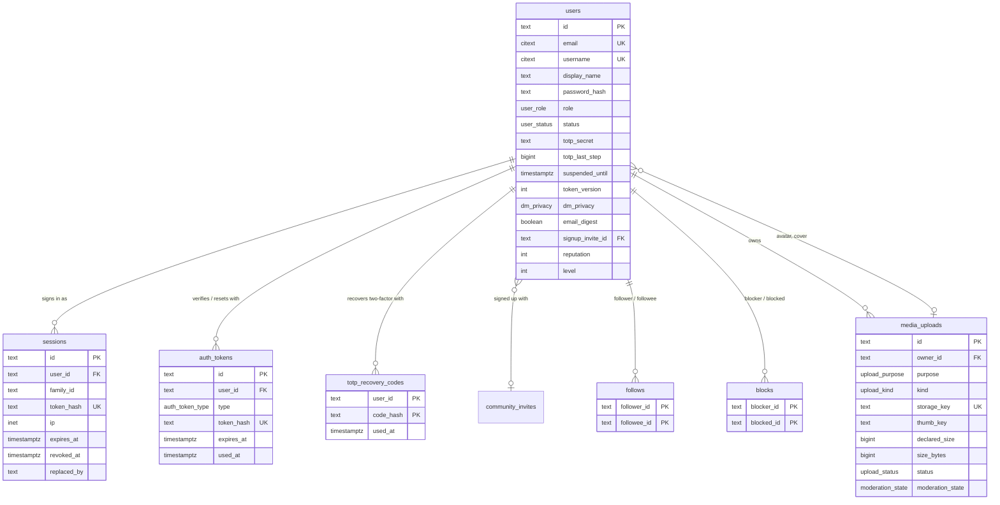
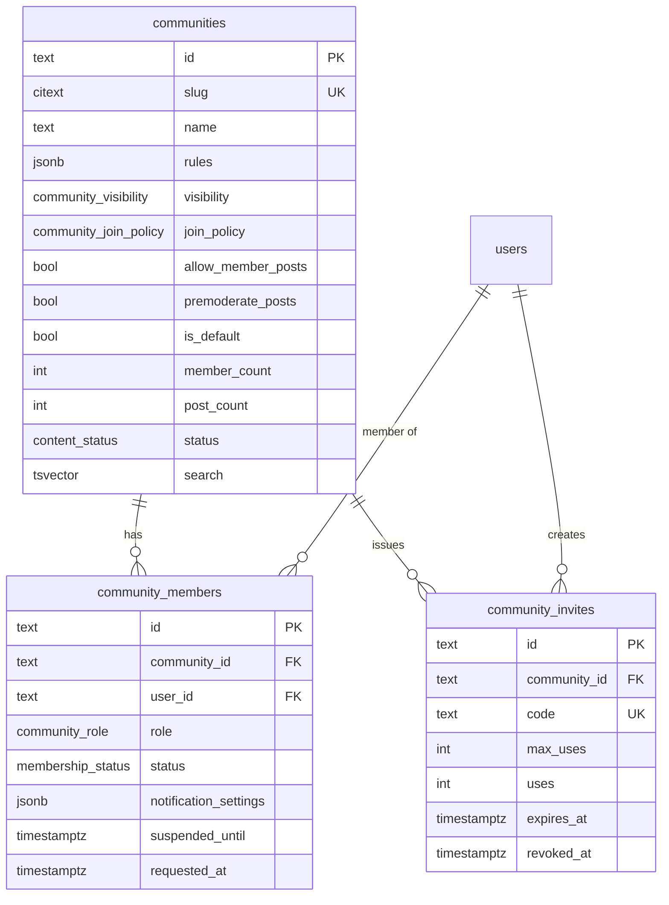
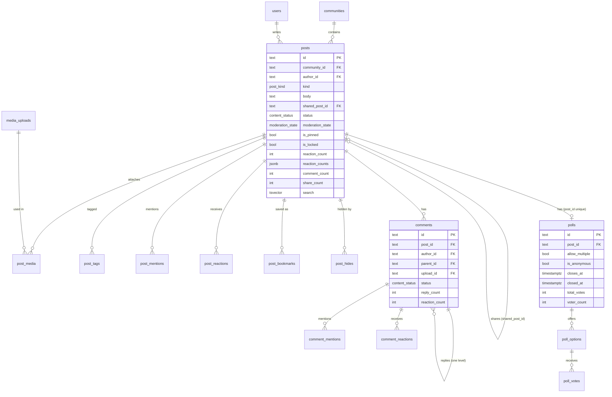
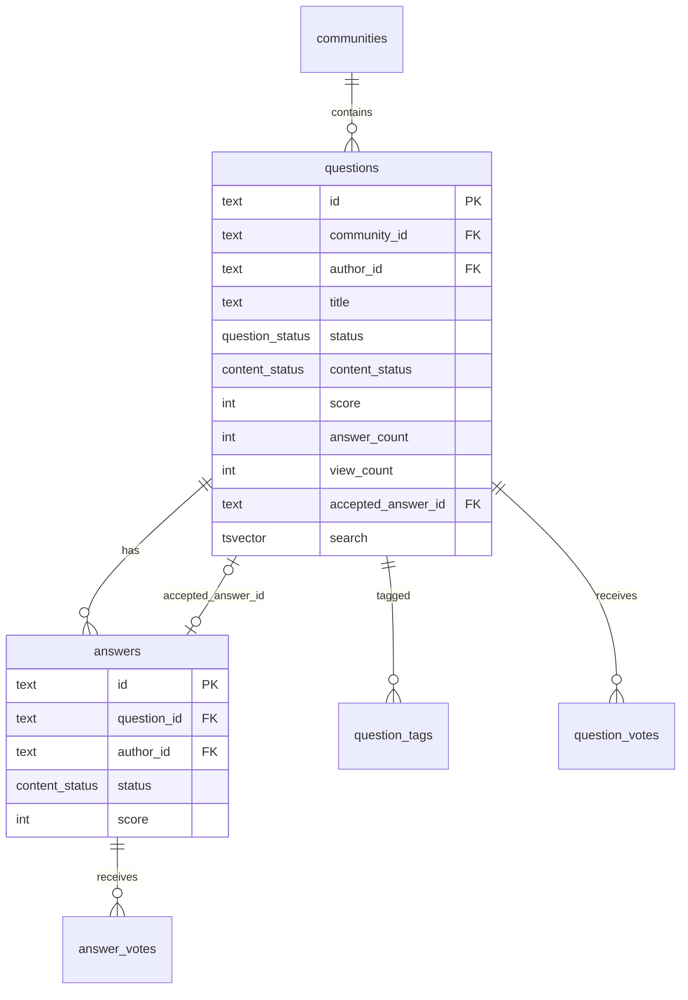
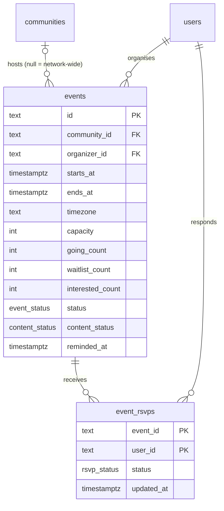
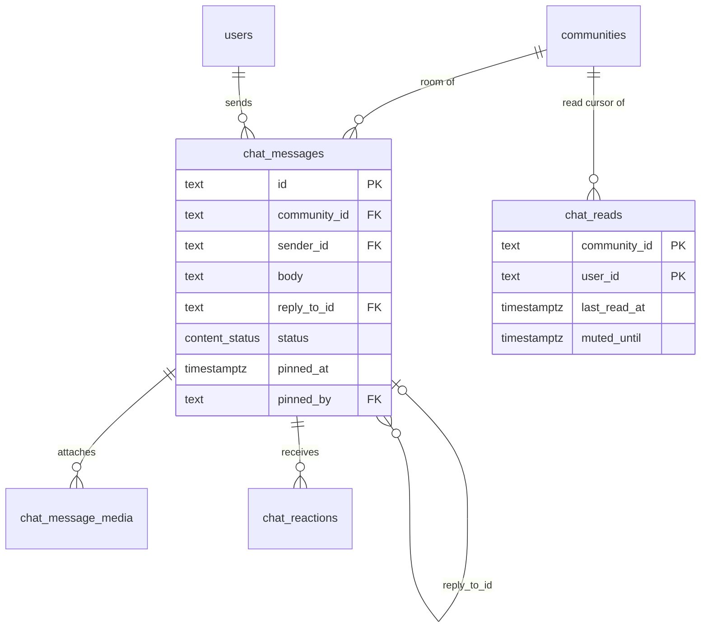
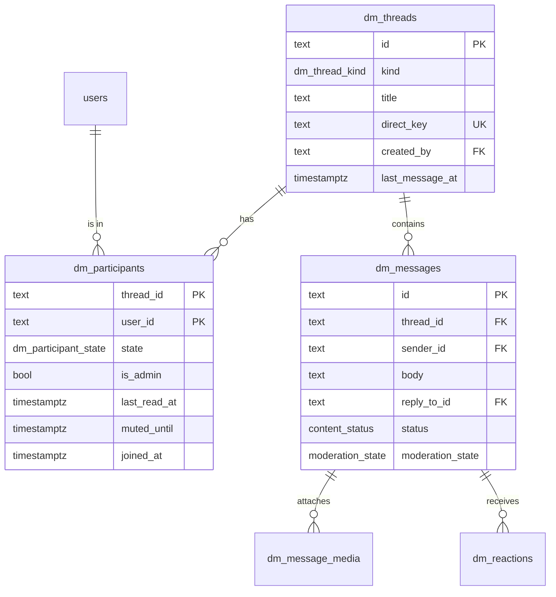
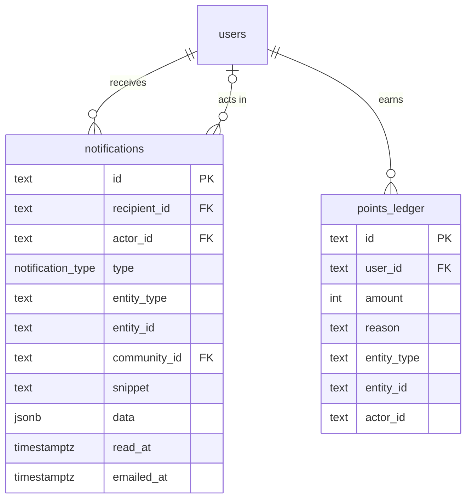
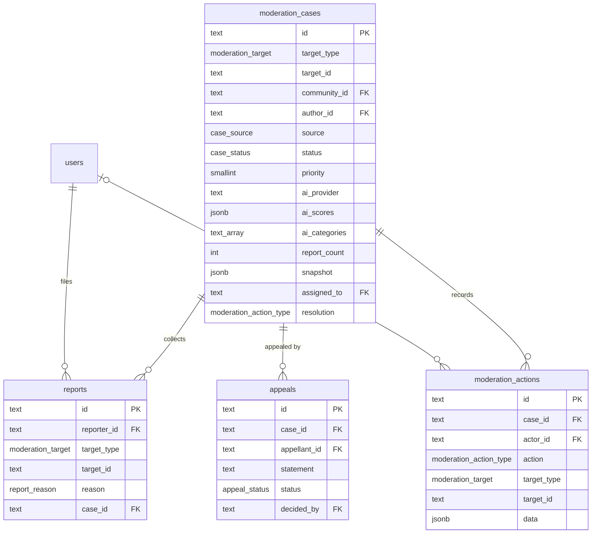

# Data model

The whole schema is one forward-only migration,
[`db/migrations/0001_init.sql`](../../db/migrations/0001_init.sql), applied by
[`db/migrate.ts`](../../db/migrate.ts). The Kysely types the API compiles against are
generated from it into [`apps/api/src/db/types.ts`](../../apps/api/src/db/types.ts)
(`pnpm --filter @open-social/api db:types`). There are 47 application tables plus the
runner's own `schema_migrations`.

## Conventions

| Convention | Why |
| --- | --- |
| Primary keys are ULIDs stored as `text` | Sortable by creation time, generated in the API (`core/ids.ts`), safe to expose. Composite natural keys where a row is a relationship (`follows`, `post_reactions`, `dm_participants`) |
| Every timestamp is `timestamptz(3)`, the API runs with `TZ=UTC` | Millisecond precision is exactly what a JS `Date` holds, so a keyset cursor built from a `Date` equals the stored value and pages never repeat or skip rows. Microsecond columns would break `(created_at, id) < ($at, $id)` at page boundaries ([ADR 0002](adr/0002-relational-schema-timestamptz3-ulids.md)) |
| `citext` for emails, usernames, slugs and tags | Case-insensitive uniqueness without `lower()` everywhere |
| Denormalised counters on the parent row | Lists show counts without `COUNT(*)`; maintained in the same transaction and reconciled every 6 hours, counting `PUBLISHED` items only |
| One `content_status` enum for every user-generated item | Feeds, moderation and counters share one lifecycle |
| Lists page with keyset cursors on `(created_at, id)` (or a score), never `OFFSET` | Each list has a matching index; see [ADR 0004](adr/0004-keyset-pagination.md) |
| Foreign keys cascade from users and communities | Deleting a user row removes their content; there is no account deletion endpoint today, so this matters for manual operations only |
| No tenant column anywhere | One deployment is one network ([ADR 0001](adr/0001-single-network-per-deployment.md)) |

Extensions: `citext` and `pg_trgm`.

## Enums

| Enum | Values |
| --- | --- |
| `user_role` | `USER`, `MODERATOR`, `ADMIN` |
| `user_status` | `PENDING_VERIFICATION`, `ACTIVE`, `SUSPENDED`, `BANNED`, `DEACTIVATED` |
| `dm_privacy` | `COMMUNITIES`, `FOLLOWING`, `NOBODY` |
| `auth_token_type` | `VERIFY_EMAIL`, `RESET_PASSWORD` |
| `community_visibility` | `PUBLIC`, `PRIVATE` |
| `community_join_policy` | `OPEN`, `APPROVAL`, `INVITE_ONLY` |
| `community_role` | `OWNER`, `ADMIN`, `MODERATOR`, `MEMBER` |
| `membership_status` | `ACTIVE`, `PENDING`, `SUSPENDED`, `BANNED`, `LEFT` |
| `upload_purpose` | `POST`, `COMMENT`, `CHAT`, `DM`, `AVATAR`, `COVER`, `COMMUNITY_ICON`, `COMMUNITY_COVER`, `EVENT_COVER` |
| `upload_kind` | `IMAGE`, `VIDEO`, `AUDIO`, `PDF`, `DOCUMENT`, `OTHER` |
| `upload_status` | `PENDING`, `COMPLETE`, `READY`, `REJECTED`, `DELETED` |
| `content_status` | `PUBLISHED`, `PENDING_REVIEW`, `HIDDEN` (taken down pending review, restorable), `REMOVED` (moderator removal), `DELETED` (the author deleted it) |
| `moderation_state` | `UNCHECKED`, `CLEAN`, `REVIEW`, `FLAGGED` |
| `post_kind` | `POST`, `ANNOUNCEMENT` |
| `reaction_type` | `LIKE`, `LOVE`, `CARE`, `HAHA`, `WOW`, `SAD`, `ANGRY` |
| `question_status` | `OPEN`, `RESOLVED`, `CLOSED` |
| `event_status` | `SCHEDULED`, `CANCELLED` |
| `rsvp_status` | `GOING`, `WAITLISTED`, `INTERESTED`, `CANCELLED` (the service treats a stored `CANCELLED` as no RSVP; removing an RSVP deletes the row) |
| `dm_thread_kind` | `DIRECT`, `GROUP` |
| `dm_participant_state` | `ACTIVE`, `REQUESTED`, `DECLINED`, `LEFT` |
| `notification_type` | `POST_COMMENT`, `COMMENT_REPLY`, `POST_REACTION`, `COMMENT_REACTION`, `MENTION`, `FOLLOW`, `JOIN_REQUEST`, `MEMBERSHIP_APPROVED`, `COMMUNITY_INVITE`, `DM_REQUEST`, `EVENT_UPDATED`, `EVENT_CANCELLED`, `EVENT_PROMOTED`, `EVENT_REMINDER`, `ANSWER_POSTED`, `ANSWER_ACCEPTED`, `MODERATION_ACTION`, `APPEAL_DECIDED` |
| `moderation_target` | `POST`, `COMMENT`, `CHAT_MESSAGE`, `DM_MESSAGE`, `QUESTION`, `ANSWER`, `EVENT`, `USER`, `COMMUNITY` |
| `report_reason` | `SPAM`, `HARASSMENT`, `HATE`, `VIOLENCE`, `SEXUAL`, `SELF_HARM`, `MISINFORMATION`, `IMPERSONATION`, `OTHER` |
| `case_source` | `AI`, `REPORT`, `PREMODERATION` |
| `case_status` | `OPEN`, `RESOLVED` |
| `moderation_action_type` | `APPROVE`, `HIDE`, `REMOVE`, `RESTORE`, `WARN`, `SUSPEND`, `BAN`, `UNBAN`, `DISMISS` |
| `appeal_status` | `PENDING`, `UPHELD`, `OVERTURNED` |

`DEACTIVATED` is set by account deletion (`DELETE /api/users/me`), which also anonymises the
row. Defined but not used by any code path today: the `COMMUNITY_INVITE` notification type
(invites are links, nobody is notified) and the `OTHER` upload kind (its size limit is 0, so nothing can be uploaded as `OTHER`).

## Tables by domain

Each diagram shows key columns only; the migration is the reference for the rest.

### Identity

| Table | Holds | Notes |
| --- | --- | --- |
| `users` | Accounts and profiles | `username` CHECK `^[a-zA-Z0-9_]{3,30}$`; profile text has length CHECKs (headline 120, bio 1000, location 100, website 200); `totp_secret` is AES-256-GCM ciphertext bound to the user id (key from `TOTP_ENCRYPTION_KEY`); `totp_last_step` makes a TOTP code single-use; `token_version` invalidates access tokens; `email_digest` is the digest opt-out; `signup_invite_id` (FK to `community_invites`, added after that table, `ON DELETE SET NULL`) holds the invite an INVITE_ONLY sign-up used until verification joins its community; there is no lockout state (sign-in failures are throttled in Redis); `post_count`, `follower_count`, `following_count`, `reputation`, `level` are counters |
| `sessions` | One row per refresh token | Only the SHA-256 is stored; `family_id` groups every rotation of one sign-in; `replaced_by` marks a rotated token (reuse detection) |
| `auth_tokens` | Email verification and password reset tokens | SHA-256 only; single use (`used_at`) |
| `totp_recovery_codes` | Ten single-use two-factor recovery codes per enrolment | PK `(user_id, code_hash)`; only an HMAC-SHA256 of each code (keyed from `TOTP_ENCRYPTION_KEY`, salted with the user id); `used_at` set atomically when spent; replaced on regenerate, deleted when TOTP is turned off |
| `follows` | The follow graph | CHECK no self-follow |
| `blocks` | Blocks | One-directional in storage, symmetric in effect: every visibility query checks both directions ([`repositories/visibility.ts`](../../apps/api/src/repositories/visibility.ts)). Blocking removes follows both ways |
| `media_uploads` | Every uploaded file | Created first (its FK to `users` is added after `users` exists, `ON DELETE CASCADE`); the storage key is server-chosen. See [media.md](media.md) |

### Communities

| Table | Holds | Notes |
| --- | --- | --- |
| `communities` | Communities | `slug` CHECK `^[a-z0-9][a-z0-9-]{1,78}[a-z0-9]$`; `rules` is `[{ title, body }]`; `is_default` communities are joined by every new account; `search` is a generated tsvector over name and description |
| `community_members` | Memberships | `UNIQUE (community_id, user_id)`: one row per person per community, whose status moves through the state machine in [LLD.md](LLD.md) |
| `community_invites` | Invite links | `code` is 9 random bytes |

### Content: posts, comments, reactions, polls

| Table | Holds | Notes |
| --- | --- | --- |
| `posts` | Posts and announcements | `body` up to 20000; `reaction_counts` is `{ "LIKE": 3, "LOVE": 1 }`; `search` generated from the body |
| `post_media` | Ordered attachments | PK `(post_id, upload_id)`, `position` |
| `post_tags` | Hashtags | `tag` citext CHECK `^[a-zA-Z0-9_]{1,40}$` |
| `post_mentions`, `comment_mentions` | Resolved @mentions | |
| `post_reactions`, `comment_reactions` | One reaction per person | PK `(post_id, user_id)` / `(comment_id, user_id)` |
| `post_bookmarks` | Saved posts | |
| `post_hides` | "Hide from my feed" | Not moderation |
| `comments` | Comments and replies | `parent_id` points at the top-level comment only; `upload_id` is one optional attachment; body up to 10000 |
| `polls`, `poll_options`, `poll_votes` | Polls | 2 to 8 options (validated by the API), `UNIQUE (poll_id, position)`; a vote row per chosen option, PK `(option_id, user_id)` |

### Q&A

| Table | Notes |
| --- | --- |
| `questions` | Title 10 to 300 characters; `status` (Q&A state) is separate from `content_status` (moderation lifecycle); the accepted-answer FK is added after `answers` exists, `ON DELETE SET NULL` |
| `answers` | Body 1 to 20000 |
| `question_tags` | Same tag rules as posts |
| `question_votes`, `answer_votes` | `value` CHECK in (-1, 1); PK per voter |

### Events

`events` CHECKs `ends_at > starts_at` and `capacity > 0`; `virtual_link` is shown only to the
organiser and people going. `event_rsvps.updated_at` is the waitlist position.

### Community chat

`chat_reactions` has PK `(message_id, user_id, emoji)`, so one person can add several
emoji. Bodies are at most 8000 characters.

### Direct messages

`dm_threads` CHECKs `(kind = 'DIRECT') = (direct_key IS NOT NULL)`. A direct thread's
`direct_key` is `"<lowerId>:<higherId>"`, and its `UNIQUE` constraint makes find-or-create
race-free without advisory locks. `dm_participants.state` drives message requests (see
[LLD.md](LLD.md)).

### Notifications and points

`notifications.data` carries what `hrefFor()` needs (post id, comment id, slug, thread id,
case id). `points_ledger` has `UNIQUE (user_id, reason, entity_type, entity_id, actor_id)`:
"award once" is a plain insert and "revoke" deletes exactly that row. The API never stores
a null `actor_id`, because nulls are distinct in a unique constraint and would defeat it.

### Moderation

| Table | Notes |
| --- | --- |
| `moderation_cases` | Polymorphic target (`target_type`, `target_id`, no FK); `snapshot` is the content as it was when the case opened (body, title, media ids, author, status); `community_id` decides which community moderators see it (null for DM, account and community cases) |
| `reports` | `UNIQUE (reporter_id, target_type, target_id)`: one report per person per target, ever |
| `moderation_actions` | Every action, automated ones with `actor_id` null; moderator removals through the ordinary delete endpoints (posts, comments, questions, answers, chat messages) are recorded here as `REMOVE` without a case |
| `appeals` | `UNIQUE (case_id, appellant_id)`; statement 10 to 2000 characters |

### Platform

| Table | Notes |
| --- | --- |
| `settings` | `key` / `value jsonb`; the API uses one key, `platform` (see [configuration.md](../guides/configuration.md#platform-settings)) |
| `audit_log` | Security and administrative actions: actor, action, entity, IP, data |
| `schema_migrations` | Created by the runner: file name, SHA-256 checksum, applied time |

## Important indexes

### Uniqueness that carries a rule

| Index | Rule |
| --- | --- |
| `moderation_cases_open_target_idx` UNIQUE `(target_type, target_id) WHERE status = 'OPEN'` | At most one open case per target; `openCase()` inserts with `ON CONFLICT ... WHERE status = 'OPEN' DO NOTHING` and joins the existing case otherwise |
| `dm_threads.direct_key` UNIQUE | One direct thread per pair |
| `community_members (community_id, user_id)` UNIQUE | One membership row per person and community |
| `reports (reporter_id, target_type, target_id)` UNIQUE | One report per reporter and target |
| `appeals (case_id, appellant_id)` UNIQUE | One appeal per case |
| `points_ledger (user_id, reason, entity_type, entity_id, actor_id)` UNIQUE | Idempotent awards |
| `sessions.token_hash`, `auth_tokens.token_hash` UNIQUE | Token lookup |
| `media_uploads.storage_key` UNIQUE | One row per object |

### Keyset lists

| Index | Serves |
| --- | --- |
| `posts_feed_idx (created_at DESC, id DESC) WHERE status = 'PUBLISHED'` | Home feed `latest` |
| `posts_community_feed_idx (community_id, created_at DESC, id DESC) WHERE status = 'PUBLISHED'` | Community `new` |
| `posts_author_idx (author_id, created_at DESC, id DESC)` | Profiles (all statuses, the author sees pending and hidden posts) |
| `posts_pinned_idx (community_id, pinned_at DESC) WHERE is_pinned` | Pinned posts |
| `comments_post_idx (post_id, created_at, id) WHERE parent_id IS NULL`, `comments_parent_idx (parent_id, created_at, id) WHERE parent_id IS NOT NULL` | Top-level comments and replies, oldest first |
| `questions_community_idx (community_id, created_at DESC, id DESC) WHERE content_status = 'PUBLISHED'` | Q&A lists |
| `answers_question_idx (question_id, score DESC, created_at)` | Answers by score |
| `events_upcoming_idx (starts_at) WHERE status = 'SCHEDULED' AND content_status = 'PUBLISHED'`, `events_community_idx (community_id, starts_at)` | Event lists |
| `event_rsvps_waitlist_idx (event_id, updated_at) WHERE status = 'WAITLISTED'` | First-come, first-served promotion |
| `chat_messages_room_idx (community_id, created_at DESC, id DESC)` | Chat history |
| `dm_messages_thread_idx (thread_id, created_at DESC, id DESC)` | DM history, last message per thread (`DISTINCT ON`), unread counts |
| `dm_participants_user_idx (user_id, state)` | Inbox and requests folders |
| `notifications_inbox_idx (recipient_id, created_at DESC, id DESC)`, `notifications_unread_idx (recipient_id) WHERE read_at IS NULL` | Inbox and the unread badge |
| `moderation_cases_queue_idx (priority DESC, opened_at) WHERE status = 'OPEN'` | The moderation queue |
| `appeals_pending_idx (created_at) WHERE status = 'PENDING'` | Pending appeals |
| `audit_log_recent_idx (created_at DESC, id DESC)` | Audit log |
| `media_uploads_pending_idx (created_at) WHERE status = 'PENDING'` | Upload expiry |
| `community_members_pending_idx (community_id, requested_at) WHERE status = 'PENDING'` | Join requests |
| `community_members_user_idx (user_id) WHERE status = 'ACTIVE'` | "My communities", shared-community checks |
| `users_reputation_idx (reputation DESC) WHERE status = 'ACTIVE'`, `points_ledger_recent_idx (created_at DESC, user_id)` | Leaderboards |

### Search

| Index | Kind | Matched by |
| --- | --- | --- |
| `users_name_trgm_idx` on `(display_name || ' ' || username::text)` | GIN `gin_trgm_ops` | `userNameLike()` and the admin directory use exactly this expression with `ILIKE` |
| `communities_name_trgm_idx` on `name` | GIN trigram | Community search `ILIKE` |
| `communities_search_idx`, `posts_search_idx`, `questions_search_idx` on the generated `search` tsvectors | GIN | `tsMatches()`: a prefix `to_tsquery('simple', ...)` built only from word characters ([`repositories/text-search.ts`](../../apps/api/src/repositories/text-search.ts)) |
| `chat_messages_search_idx` on `to_tsvector('simple', body)` | GIN | No endpoint searches chat yet. DM search (per thread) uses `to_tsvector` on `dm_messages.body` without an index, bounded by the thread |

## Why `timestamptz(3)`

PostgreSQL stores microseconds by default; JavaScript dates hold milliseconds. A cursor
carrying `2026-01-02T03:04:05.678Z` compared with a stored `...05.678912` treats the row as
newer than the cursor, so the last row of a page reappears on the next page (or, in the
other direction, is skipped). Declaring every column `timestamptz(3)` makes the stored
value exactly representable as a `Date`, so the `Date`-based cursors in
[`core/cursor.ts`](../../apps/api/src/core/cursor.ts) are exact. The social lists use
[`repositories/keyset.ts`](../../apps/api/src/repositories/keyset.ts), which reads the column as
text (`atKey()`) and would be exact at any precision; the moderation and admin lists also
wrap columns in `date_trunc('milliseconds', ...)` (`msOf`), which is redundant with this
schema. The API pins `TZ=UTC` and registers a UTC parser for `timestamp without time zone`
(never used by the schema) in [`db/kysely.ts`](../../apps/api/src/db/kysely.ts).

## Migrations

- Files are `db/migrations/NNNN_name.sql`, applied in name order, each in its own
  transaction, recorded with a SHA-256 checksum. Changing an applied file stops the runner
  (`... changed after it was applied; add a new migration instead`).
- A Postgres advisory lock (`727101`) serialises concurrent runs: two deploys, or several
  API tasks booting with `MIGRATE_ON_BOOT=true`.
- `pnpm db:migrate --status` lists applied and pending files without changing anything.
- Locally the compose `migrate` one-shot runs before `api` and `worker`; on AWS
  `make aws-deploy` runs the migrate task before rolling out services, and `make aws-migrate`
  runs it alone. See [operations.md](../guides/operations.md).
