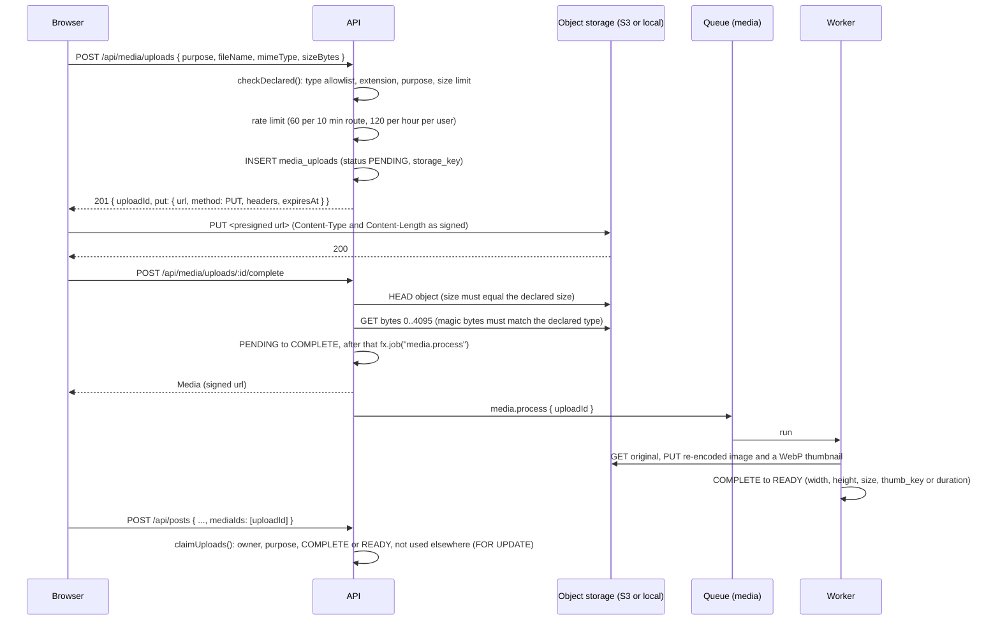

# Media

Every file in Euron Open Social (avatars, covers, community icons, post and comment
attachments, chat and DM files, event covers) goes through one upload flow: the browser
asks the API for a short-lived presigned PUT, sends the bytes straight to object storage,
then asks the API to confirm. The API checks what actually landed before anything can use
it. Content refers to files only by upload id; no client-supplied URL or storage key is
ever accepted.

All paths below are under [`apps/api/src`](../../apps/api/src) unless stated otherwise. The decision is
recorded in [ADR 0010](adr/0010-presigned-uploads-by-upload-id.md).

## 1. Upload sequence

Code: [`services/media.service.ts`](../../apps/api/src/services/media.service.ts) (`createUpload`, `completeUpload`,
`processUpload`, `expireUploads`), [`services/media-attach.service.ts`](../../apps/api/src/services/media-attach.service.ts)
(`claimUploads`, `claimSingle`), [`domain/media-rules.ts`](../../apps/api/src/domain/media-rules.ts) (the policy),
[`integrations/storage.ts`](../../apps/api/src/integrations/storage.ts) (the two backends). The browser side is
[`packages/api-client/src/upload.ts`](../../packages/api-client/src/upload.ts), which uploads with an `XMLHttpRequest`
for progress events.

## 2. What may be uploaded

[`domain/media-rules.ts`](../../apps/api/src/domain/media-rules.ts) is pure and unit-tested
([`test/unit/media-rules.test.ts`](../../apps/api/test/unit/media-rules.test.ts)). Three checks, all required:

1. the declared MIME type is on the allowlist (parameters such as `; charset=` are dropped
   and case is ignored);
2. the file extension belongs to that type (no `invoice.pdf` that is declared as an image);
3. after the upload, the first bytes of the stored object match the type's magic number.
   This runs on what landed in storage, never on client input.

| Kind | Size limit | MIME types (extensions) | Sniffed as |
| --- | --- | --- | --- |
| IMAGE | 15 MB | `image/jpeg` (jpg, jpeg), `image/png` (png), `image/webp` (webp), `image/gif` (gif), `image/heic` and `image/heif` (heic, heif) | JPEG SOI, PNG signature, `RIFF....WEBP`, `GIF87a`/`GIF89a`, an ISO BMFF `ftyp` box with a HEIF brand |
| VIDEO | 200 MB | `video/mp4` (mp4, m4v), `video/webm` (webm), `video/quicktime` (mov, qt) | `ftyp` brand that is not HEIF (and not `qt  ` for MP4), EBML header containing `webm`, `ftyp qt` or an old QuickTime atom |
| AUDIO | 50 MB | `audio/mpeg` (mp3), `audio/mp4` and `audio/x-m4a` (m4a), `audio/ogg` (ogg, oga, opus), `audio/wav`, `audio/x-wav`, `audio/wave` (wav) | `ID3` or an MPEG frame sync, an `ftyp` box whose major brand is `M4A `, `M4B ` or `M4P ` (so an MP4 video cannot pass as audio), `OggS`, `RIFF....WAVE` |
| PDF | 25 MB | `application/pdf` (pdf) | `%PDF-` |
| DOCUMENT | 25 MB | DOCX, XLSX, PPTX (the OOXML types), `text/csv` (csv), `text/plain` (txt) | ZIP local header for OOXML; for text: valid UTF-8, no NUL bytes, no markup |

Refused by name, whatever else is declared: `image/svg+xml`, `text/html`,
`application/xhtml+xml`, `text/xml`, `application/xml`, `text/javascript`,
`application/javascript`, `application/x-sh`, and the extensions `svg`, `svgz`, `html`,
`htm`, `xhtml`, `xml`, `js`, `mjs`, `exe`, `bat`, `cmd`, `sh`, `php`. These types run
scripts when opened from a signed URL. On top of the magic number, any non-document file
whose first kilobyte starts like markup (`<?xml`, `<!doctype`, `<html`, `<svg`, `<script`,
and similar) fails the sniff (`looksLikeMarkup`).

Each purpose accepts some kinds (`PURPOSE_KINDS`):

| Purpose | Kinds |
| --- | --- |
| `POST`, `CHAT`, `DM` | IMAGE, VIDEO, AUDIO, PDF, DOCUMENT |
| `COMMENT` | IMAGE, VIDEO |
| `AVATAR`, `COVER`, `COMMUNITY_ICON`, `COMMUNITY_COVER`, `EVENT_COVER` | IMAGE |

Error codes from `createUpload`: `MEDIA_TYPE_NOT_ALLOWED`, `MEDIA_EXTENSION_MISMATCH`,
`MEDIA_PURPOSE_MISMATCH`, `MEDIA_EMPTY` (400) and `MEDIA_TOO_LARGE` (413, with
`details.maxBytes`). From `completeUpload`: `UPLOAD_MISSING`, `MEDIA_SIZE_MISMATCH`,
`MEDIA_TYPE_MISMATCH`, `MEDIA_REJECTED`. A size or content mismatch marks the row
`REJECTED` with a reason and deletes the object.

## 3. Upload lifecycle

| Status | Meaning |
| --- | --- |
| `PENDING` | Row created and PUT URL issued; nothing verified |
| `COMPLETE` | Size and magic bytes verified; processing queued. Attachable; served when not an image (an image is shown only to its uploader until `READY`) |
| `READY` | Processed (images re-encoded with a thumbnail; video and audio with a duration when parseable) |
| `REJECTED` | Failed verification or could not be decoded (including HEIC this server cannot decode); the object is deleted and `rejected_reason` says why |
| `DELETED` | Deleted by its owner (only while not attached) |

`moderation_state` on the row (`UNCHECKED`, `CLEAN`, `REVIEW`, `FLAGGED`) is set when a
scan covers the image as part of the content it is attached to ([moderation.md](moderation.md)).

**Attaching.** `claimUploads` (posts, chat, DMs, comments) locks the rows `FOR UPDATE`
inside the caller's transaction and requires: same owner, matching purpose, status
`COMPLETE` or `READY`, and not already attached in the table for that purpose (each file
attaches once). `claimSingle` (avatars, covers, icons, event covers) requires owner,
purpose, a finished upload and kind IMAGE, and allows reuse. Any failure is
`400 MEDIA_INVALID`, `MEDIA_NOT_READY` or `MEDIA_IN_USE`.

**Reading.** `GET /api/media/:id` returns the `Media` DTO only to its owner, platform staff,
or someone who can see something it is attached to (`canSeeParent`: a PUBLISHED post or
comment in a readable community without a block, a chat message in a community where the
viewer is an ACTIVE member, a DM thread the viewer is in, a visible profile, a published
community, a published event). Unattached uploads are visible to their owner only, and an
image that is not `READY` yet is a 404 for everyone but its owner. Lists and detail
responses embed media through `loadMedia` in
[`presenters/media.presenter.ts`](../../apps/api/src/presenters/media.presenter.ts), which signs URLs per response and omits
uploads that are not `COMPLETE` or `READY`, and images that are not `READY`
(`isPresentable`): until processing has stripped EXIF and GPS, nobody else sees them.

## 4. Storage

### Keys

`media/<purpose>/<yyyy>/<mm>/<uploadId>.<ext>` (lower-case purpose, UTC year and month,
the canonical extension of the type). Nothing from the client's file name is used; the
cleaned name (`cleanFileName`: last path segment, control characters and `"<>` replaced,
200 characters) is kept only for display and download names. Thumbnails are stored next
to the original as `<key>.thumb.webp`.

### S3 (production and the Floci stack)

- A private bucket: Block Public Access on all four settings, `BucketOwnerEnforced`,
  SSE-KMS with the deployment key and bucket keys, versioning, and a bucket policy that
  denies any request without TLS ([`infra/terraform/modules/storage/main.tf`](../../infra/terraform/modules/storage/main.tf)).
- **Presigned PUT**: 600 s, signing `content-type` and `content-length`, so the browser
  must send exactly the declared type and size. The response returns the `Content-Type`
  header the client has to send.
- **Presigned GET**: `SIGNED_URL_TTL_SECONDS` (default 900). PDF, DOCUMENT and OTHER kinds
  get `ResponseContentDisposition: attachment` with the cleaned file name, so they download
  rather than render. URLs are minted per API response; the web app refetches the parent
  rather than caching them.
- Presigning uses `S3_PUBLIC_ENDPOINT` when set (locally the emulator on
  `http://localhost:4577`), so the URL the browser receives is reachable from the host while
  the API itself talks to the emulator on the compose network.
- **Checksum note.** The S3 client is created with
  `requestChecksumCalculation: "WHEN_REQUIRED"`. AWS SDK v3 otherwise adds a CRC32 of the
  (empty) body to presigned URLs, and S3 then rejects the browser's real upload with
  `BadDigest` (see [troubleshooting.md](../guides/troubleshooting.md)).
- **CORS**: `PUT`, `GET`, `HEAD` from the app origin plus `media_cors_extra_origins`;
  allowed headers `Content-Type`, `Content-MD5`, `x-amz-*`; `ETag` exposed; max age 3000 s.
  Locally the origin is `http://localhost:3510` ([`envs/local-floci/main.tf`](../../infra/terraform/envs/local-floci/main.tf)).
- **Lifecycle**: incomplete multipart uploads aborted after 1 day; noncurrent versions
  (replaced or deleted objects) expire after `noncurrent_version_days` (default 30).
  Current objects never expire by rule; the API's expiry job deletes unattached ones.
- **IAM**: the API and worker task role may `GetObject` (which also covers `HEAD`),
  `PutObject` and `DeleteObject` on the bucket's objects, and use the KMS key only through
  S3 (`kms:ViaService`) ([`modules/deployment/main.tf`](../../infra/terraform/modules/deployment/main.tf)).
- The web app's Content-Security-Policy must allow the bucket origin for images, media
  and the upload `connect-src`: `MEDIA_ORIGINS` ([`apps/web/src/middleware.ts`](../../apps/web/src/middleware.ts)).

### Local mode (`STORAGE=local`, development only)

Files live under `DATA_DIR/media` (default `./data`). The API itself serves the stand-ins
for presigned URLs, so the browser flow is identical:

- `PUT /api/media/local/:token` and `GET /api/media/local/:token` take no bearer token; the
  token is the only authority, like a presigned URL.
- A token is `base64url(op|key|exp|extra).HMAC-SHA256`, keyed with
  `sha256(REFRESH_SECRET + ":local-media")`. PUT tokens (600 s) carry the signed type and
  size; the route rejects a different `Content-Type`, a different `Content-Length`, or a
  body larger than signed. GET tokens live `SIGNED_URL_TTL_SECONDS`.
- Keys are resolved inside the media directory or refused, so a key cannot escape it.
- GET answers with `X-Content-Type-Options: nosniff`, `Cache-Control: private, max-age=300`,
  `inline` for images and video and `attachment` for everything else.
- The request log masks the token (`/media/local/[signed]`, [`app.ts`](../../apps/api/src/app.ts)).

`assertProductionConfig` refuses `STORAGE=local` in production
([`core/config.ts`](../../apps/api/src/core/config.ts)).

## 5. Processing

`media.process` runs in the worker (or inline in tests) and only on `COMPLETE` rows:

- **Images**: read the original, re-encode with sharp (`failOn: "error"`, `rotate()` to
  apply and drop the EXIF orientation; JPEG with mozjpeg at quality 88, PNG, WebP 88, GIF;
  GIF and WebP keep their animation). sharp writes no metadata unless asked, so EXIF and GPS
  are dropped. The re-encoded file replaces the original under the same key, and a 640 px
  wide WebP thumbnail (quality 80, never enlarged, first frame only) is written next to it.
  Width, height (page height for animations) and the new size are stored, then `READY`.
- **HEIC and HEIF**: the bundled libvips usually cannot decode HEVC. When decoding fails
  the upload is `REJECTED` with the reason "HEIC photos cannot be processed on this server;
  export the photo as JPEG and upload it again" and the object is deleted, because serving
  the original would publish its metadata.
- **Other images that fail to decode**: `REJECTED`, object deleted.
- **Video and audio** up to 100 MB: the file is read once to find a duration (the `mvhd`
  box for MP4, MOV and M4A; the data chunk and byte rate for WAV); WebM, Ogg and MP3 get
  none. Then `READY`. Larger files skip the duration.
- **PDF and documents**: straight to `READY`.

Transitions use `WHERE status IN (...)`, so a retried job never processes a row twice.

## 6. Expiry

`maintenance.expire-uploads` runs every 30 minutes ([`worker.ts`](../../apps/api/src/worker.ts)) and deletes,
in batches of 500 (at most 20 rounds), the rows `findExpired` selects
([`repositories/media.repository.ts`](../../apps/api/src/repositories/media.repository.ts)):

- `PENDING` uploads older than 24 hours (never completed);
- every `REJECTED` upload;
- `COMPLETE` or `READY` uploads older than 48 hours that nothing references.

"Referenced" has one definition (`REFERENCES` in the repository): `post_media`,
`comments.upload_id`, `chat_message_media`, `dm_message_media`, user avatar or cover,
community icon or cover, event cover. The delete re-checks it in the same statement, so an
upload attached between selection and deletion survives. After the row is gone the object
and its thumbnail are deleted from storage. Owners can delete an unattached upload at any
time (`DELETE /api/media/uploads/:id`, `409 MEDIA_IN_USE` once attached).

## 7. Testing

[`media.int.test.ts`](../../apps/api/test/integration/media.int.test.ts) covers the flow end to end, and the
test matrix runs it with `STORAGE=local` and `STORAGE=s3` on the emulator
(`make test-matrix ONLY=s3`, see [testing.md](../guides/testing.md)).

## 8. Known gaps

Stated as the code behaves today; the full list is in [security.md](security.md#known-limitations).

- **Only images are re-encoded.** Video, audio, PDF and documents are served exactly as
  uploaded, with any embedded metadata (for example location in phone videos, or document
  author fields).
- **HEIC needs a decoder.** Without HEVC support in libvips, HEIC uploads are refused rather
  than converted.
- **A stuck worker hides new images.** Images appear only once `READY`, so while
  `media.process` cannot run they stay invisible to everyone but their uploader.
- **Signed URLs outlive permission changes.** A URL handed out stays valid until it expires
  (`SIGNED_URL_TTL_SECONDS`), even if the viewer is blocked or the content is hidden
  meanwhile.
- **Inline jobs.** With `JOBS_MODE=inline` a failed `media.process` is logged and dropped,
  and the expiry job never runs (there is no scheduler in the API process).
