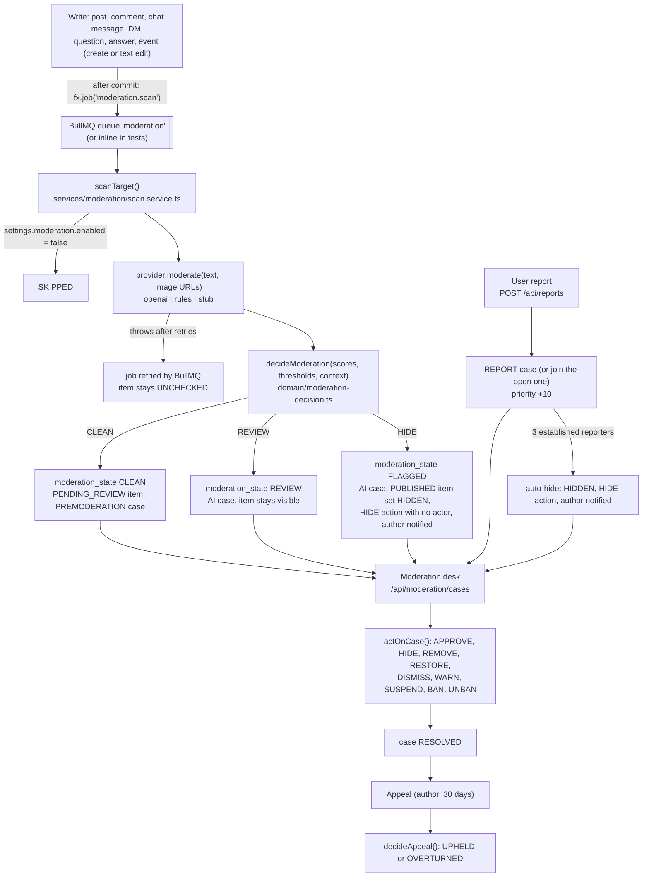

# Moderation

How Euron Open Social keeps content in check: an automated classifier pass over new and
edited content, user reports, a case queue shared by platform staff and community
moderators, moderator actions, appeals, and the trail every step leaves. The day-to-day
procedure for moderators is in [moderation-playbook.md](../guides/moderation-playbook.md); this page describes the
mechanism.

All paths below are under [`apps/api/src`](../../apps/api/src) unless stated otherwise.

## 1. Pipeline

Enqueueing happens only after the write commits (see [LLD.md](LLD.md) for the `Effects`
buffer), so a rolled-back post is never scanned. The scan jobs are queued from
`post.service.ts`, `comment.service.ts`, `chat.service.ts`, `dm.service.ts`,
`question.service.ts` and `event.service.ts`, on create and whenever the text changes, and
from `user.service.ts` whenever a profile's public fields change (target `USER`).

## 2. Targets

[`services/moderation/targets.ts`](../../apps/api/src/services/moderation/targets.ts) has one adapter per target type, so
scans, reports, actions and appeals treat every kind of content the same way.

| Target | Table (status column) | Text scanned | Images scanned |
| --- | --- | --- | --- |
| `POST` | `posts` (`status`) | `body` | images in `post_media` |
| `COMMENT` | `comments` (`status`) | `body` | the comment's upload, if an image |
| `CHAT_MESSAGE` | `chat_messages` (`status`) | `body` | images in `chat_message_media` |
| `DM_MESSAGE` | `dm_messages` (`status`) | `body` | images in `dm_message_media` |
| `QUESTION` | `questions` (`content_status`) | `title` and `body` | none |
| `ANSWER` | `answers` (`status`) | `body` | none |
| `EVENT` | `events` (`content_status`) | `title`, `description`, `location` and `virtual_link` | the cover image |
| `USER` | `users` (`status`) | display name, headline, bio, location, website (scanned on every profile edit) | the avatar |
| `COMMUNITY` | `communities` (`status`) | name and description | icon (reports only, never scanned) |

Only the first seven are "content targets" (`CONTENT_TARGETS`). `scanTarget` also scans
`USER` (profiles) but never hides one: a `REVIEW` or `HIDE` verdict only opens an `AI` case
for a moderator. It returns `SKIPPED` for `COMMUNITY` and for deactivated accounts. Images are passed to the provider as signed GET URLs
(the thumbnail when one exists), only for uploads in `COMPLETE` or `READY`.

`setContentStatus` moves an item between statuses with a compare-and-set
(`WHERE status = <the status we loaded>`), so concurrent changes are never double counted,
and in the same transaction adjusts the denormalised counters (counts include PUBLISHED
items only: post counts and points through `counters.postPublished/postUnpublished`,
`comment_count` and `reply_count`, `answer_count`) and queues the realtime signal
(`post:removed`, `chat:message:deleted` or `:updated`, `dm:message:deleted` or `:updated`).

## 3. Providers

[`services/moderation/providers.ts`](../../apps/api/src/services/moderation/providers.ts) defines one interface,
`moderate({ text, imageUrls, recentDuplicates, blockedTerms }) -> { scores, flagged }`,
with scores from 0 to 1 per category.

| Provider | Selected by | What it does |
| --- | --- | --- |
| `openai` | `provider: "openai"` | `POST {OPENAI_BASE_URL}/moderations` with `model: OPENAI_MODERATION_MODEL` (default `omni-moderation-latest`) and a multimodal `input` array of text and `image_url` items. Bearer `OPENAI_API_KEY`. |
| `stub` | `provider: "stub"` | The same client pointed at `{MODERATION_STUB_URL}/v1` with no key: [`apps/moderation-stub`](../../apps/moderation-stub/README.md). Text markers such as `[[mod:harassment=0.97]]` set scores; an image URL containing `flag-image` scores `sexual=0.99`. For tests and local development. |
| `rules` | `provider: "rules"` (the default) | No network. A whole-word match of any platform blocked term scores `harassment = 0.9`; more than 5 links, or 3 or more identical messages by the same author in the same table within 10 minutes (`recentDuplicates`), scores `spam = 0.95`. |

**OpenAI-compatible client.** 10 s timeout per call, 2 retries with 250 ms and 500 ms
backoff for network errors, timeouts, 429 and 5xx; any other 4xx or a malformed body throws
at once. When every retry fails the error propagates, so the job fails and BullMQ retries
it (5 attempts, exponential backoff from 5 s, defined in
[`jobs/registry.ts`](../../apps/api/src/jobs/registry.ts)). An empty input (no text, no images) returns no scores
without a call.

**Category folding.** `foldScores` copies every category score and also folds each
`parent/child` score into its parent with `max`, so a threshold on `harassment` also
catches `harassment/threatening`, and one on `sexual` catches `sexual/minors` (which keeps
its own, stricter threshold too). With several results in a response the scores are merged
with `max`.

## Thresholds and defaults

Policy lives in platform settings, `settings.moderation`, merged over `DEFAULT_SETTINGS` in
[`services/settings.service.ts`](../../apps/api/src/services/settings.service.ts) and edited by admins through
`PATCH /api/admin/settings` (see [configuration.md](../guides/configuration.md#platform-settings)).

| Setting | Default | Meaning |
| --- | --- | --- |
| `moderation.enabled` | `true` | `false` makes every scan return `SKIPPED` |
| `moderation.provider` | `MODERATION_PROVIDER` at boot (`rules` if unset) | Which provider scans use |
| `moderation.blockedTerms` | `[]` | Terms for the `rules` provider (up to 500, 100 characters each) |
| `moderation.premoderateNewAccounts` | `{ enabled: false, firstPosts: 3, accountAgeDays: 2 }` | Hold posts from new accounts (section 5) |
| `moderation.thresholds` | below | Per category `{ review, hide }`, each 0 to 1 |

| Category | review at | hide at |
| --- | --- | --- |
| `harassment` | 0.5 | 0.85 |
| `hate` | 0.4 | 0.8 |
| `violence` | 0.5 | 0.85 |
| `sexual` | 0.5 | 0.85 |
| `sexual/minors` | 0.1 | 0.3 |
| `self-harm` | 0.3 | 0.9 |
| `illicit` | 0.6 | 0.9 |
| `spam` | 0.6 | 0.9 |

The admin controller validates thresholds strictly ([`controllers/admin.controller.ts`](../../apps/api/src/controllers/admin.controller.ts)):
both values in 0 to 1, `review <= hide`, at most 50 categories, unknown keys rejected.
Stored thresholds merge over the defaults key by key, so a default category cannot be
deleted; set `review` and `hide` to 1 to make one practically inert. Categories without a
threshold are ignored. Settings are cached per process for 5 seconds.

## 4. Decision

[`domain/moderation-decision.ts`](../../apps/api/src/domain/moderation-decision.ts) is pure and shared by every provider.

`baselineVerdict` compares each score with its thresholds: any score at or above `hide`
gives `HIDE`; otherwise any at or above `review` gives `REVIEW`; otherwise `CLEAN`. The
verdict lists the categories that crossed a threshold and gets a priority of
`round(top score * 100)`.

Provider: `settings.moderation.provider` (admin-editable). When it says `openai` but no
usable `OPENAI_API_KEY` is configured (unset, or the Terraform placeholder `set-me`), the scan
uses `rules` instead and logs a warning once per process (`effectiveProvider`).

`adjustForContext` then applies context. Today it does one thing: content by platform
staff (`ADMIN` or `MODERATOR`) is downgraded from `HIDE` to `REVIEW`. The scan already
passes `reportCount`, `authorReputation` and `authorAccountAgeDays`, but nothing uses them;
the function carries a `TODO(maintainer)` for those trade-offs.

| Verdict | `moderation_state` | Case | Item |
| --- | --- | --- | --- |
| `CLEAN` | `CLEAN` | none, except a `PREMODERATION` case for an item still `PENDING_REVIEW` | unchanged |
| `REVIEW` | `REVIEW` | `AI` case with provider, scores, categories, priority | unchanged, stays visible |
| `HIDE` | `FLAGGED` | `AI` case | if PUBLISHED: set `HIDDEN`, a `HIDE` action with `actor_id` NULL, the author is notified, the staff badge refreshes |

The scan runs the provider outside any transaction, then reloads the target inside one
and skips it if the author deleted it (or a moderator removed it) meanwhile.

## 5. Premoderation

[`services/premoderation.service.ts`](../../apps/api/src/services/premoderation.service.ts) decides whether a new post is held
(created `PENDING_REVIEW`): the community has `premoderate_posts` on, or
`premoderateNewAccounts.enabled` is on and the author's account is younger than
`accountAgeDays` and has fewer than `firstPosts` published posts. Platform staff and the
community's own moderators are never held. Only posts are premoderated.

A held post is visible to its author and the community's moderators only, is not counted,
earns no points and sends no feed signal ([`services/post.service.ts`](../../apps/api/src/services/post.service.ts)). Its
`PREMODERATION` case is opened in the same transaction that creates the post, so it reaches
the queue even with moderation off or a failing provider. A later scan joins that case
(a `REVIEW` or `HIDE` verdict adds the AI scores; a held item is not switched to `HIDDEN`,
since it is not PUBLISHED). A moderator releases it with `APPROVE`, which also sends the
mention notifications the post skipped (`post-mentions.service.ts`; anyone already told
is skipped, so restoring a post never re-notifies).

## 6. Reports

[`services/moderation/reports.service.ts`](../../apps/api/src/services/moderation/reports.service.ts), `POST /api/reports`
(20 per hour per user, [`routes/reports.routes.ts`](../../apps/api/src/routes/reports.routes.ts)).

- Any of the nine target types can be reported, with a reason (`SPAM`, `HARASSMENT`,
  `HATE`, `VIOLENCE`, `SEXUAL`, `SELF_HARM`, `MISINFORMATION`, `IMPERSONATION`, `OTHER`)
  and optional details (1000 characters).
- The reporter must be able to see the target (`visibleTo` applies the same block and
  private-community rules as the reads); otherwise 404, so reports cannot probe hidden
  content. Reporting yourself or your own content is a 400.
- One report per reporter and target: the `reports` unique key
  `(reporter_id, target_type, target_id)` turns a second one into `409 ALREADY_REPORTED`.
- The report joins the target's open case, or opens a `REPORT` case. The partial unique
  index `moderation_cases_open_target_idx` (one OPEN case per target) makes "join or open"
  race free ([`repositories/moderation.repository.ts`](../../apps/api/src/repositories/moderation.repository.ts), `openCase`).
  Each report adds 1 to `report_count` and 10 to the priority, capped at 1000.

**Auto-hide from reports** ([`domain/report-threshold.ts`](../../apps/api/src/domain/report-threshold.ts)). The content is
hidden pending review when all of these hold:

- at least 3 reporters (`AUTO_HIDE_REPORTERS`) whose reports are on the target's current
  OPEN case (filed since the last resolution), whose accounts are `ACTIVE` now and older
  than 1 day (`MIN_REPORTER_AGE_DAYS`, strictly greater);
- the target is content, never a `USER` or a `COMMUNITY`;
- the author is not platform staff;
- the target is currently `PUBLISHED`.

Auto-hide records a `HIDE` action with no actor and notifies the author. Reporters are
never shown to authors: the case detail lists report reasons and counts, not reporters
([`presenters/moderation.presenter.ts`](../../apps/api/src/presenters/moderation.presenter.ts)).

## 7. The desk and who sees what

Endpoints are in [`routes/moderation.routes.ts`](../../apps/api/src/routes/moderation.routes.ts); scoping is in
[`services/moderation/cases.service.ts`](../../apps/api/src/services/moderation/cases.service.ts).

| Who | Sees | Can do |
| --- | --- | --- |
| Platform `ADMIN` | Every case, appeals, history, stats | Everything, including `BAN` and `UNBAN` |
| Platform `MODERATOR` | Every case, appeals, history, stats | Content actions, `WARN`, `SUSPEND`; not `BAN`/`UNBAN`; cannot act on other moderators or on admins |
| Community `OWNER`, `ADMIN`, `MODERATOR` (ACTIVE membership) | Cases whose `community_id` is one of theirs | `HIDE`, `REMOVE`, `RESTORE`, `APPROVE`, `DISMISS` |
| Any signed-in user | `GET /api/moderation/me`: cases about their own content or account | Appeal |

Cases about `USER` and `COMMUNITY` targets are opened with `community_id` NULL, and DM
messages have no community, so only platform staff ever see those. The open queue sorts by
`priority` descending, then oldest first (cursor `priority|opened_at|id`); resolved cases
list newest first. Staff can assign a case to a staff member (`POST .../assign`), which
is audited.

## 8. Actions

`actOnCase` in [`services/moderation/actions.service.ts`](../../apps/api/src/services/moderation/actions.service.ts) locks the case,
checks scope, applies the action, records it and resolves the case (`status RESOLVED`,
`resolution`, `resolved_by`, `resolved_at`).

| Action | Target becomes | Allowed from |
| --- | --- | --- |
| `APPROVE` | `PUBLISHED`, `moderation_state CLEAN` | `PENDING_REVIEW`, `HIDDEN`, `PUBLISHED` |
| `HIDE` | `HIDDEN` (restorable) | `PUBLISHED`, `PENDING_REVIEW`, `HIDDEN` |
| `REMOVE` | `REMOVED` (final unless an appeal wins) | `PUBLISHED`, `PENDING_REVIEW`, `HIDDEN`, `REMOVED` |
| `RESTORE` | `PUBLISHED`, `moderation_state CLEAN` | `HIDDEN`, `REMOVED`, `PUBLISHED` |
| `DISMISS` | unchanged | any |
| `WARN` | account unchanged, the author is notified | staff only |
| `SUSPEND` | account `SUSPENDED` for `suspendDays` (1 to 3650), sockets disconnected | staff only |
| `BAN` | account `BANNED`, every session revoked, `token_version` bumped, sockets disconnected | admins only |
| `UNBAN` | account `ACTIVE` | admins only |

Account actions apply to the case's `author_id` and go through `applyAccountAction`, the
same function the admin console's account endpoints use, so both paths leave the same
trail. Nobody acts on their own account, admin accounts are out of reach (demote first),
and moderators cannot act on moderators. Lifting a suspension is recorded as `RESTORE`
with `data.kind = "UNSUSPEND"` (the action enum has no `UNSUSPEND`). Content actions on a
`USER` case are refused, and on a `COMMUNITY` case are staff only.

Acting on a case needs an `ACTIVE` account, and nobody but a platform `ADMIN` acts on a
case about their own content or account (`403 SELF_MODERATION`).

One other path records moderation without a case: a moderator deleting someone else's
post, comment, question, answer or chat message through the normal delete endpoint. It sets
`REMOVED` and writes the same trail as a case action, a `REMOVE` row in `moderation_actions`
with `case_id` NULL and an audit entry
([`services/moderation/removal.ts`](../../apps/api/src/services/moderation/removal.ts)), so the target's history shows it.

## 9. Appeals

[`services/moderation/appeals.service.ts`](../../apps/api/src/services/moderation/appeals.service.ts).

- **Who and when.** The case's author, once per case (`appeals` unique
  `(case_id, appellant_id)`), when the case is `RESOLVED` with resolution `HIDE`, `REMOVE`,
  `SUSPEND` or `BAN`, within 30 days of `resolved_at`; or while the case is still `OPEN`
  when the target was hidden automatically (a `HIDE` action with no actor, by the scan or
  the report threshold) and is still `HIDDEN`, as the author's notification promises. A statement of 10 to 2000
  characters. 10 appeals per hour per user. A suspended account can appeal (only a
  signed-in account is required); a banned account cannot sign in and appeals outside the
  product.
- **Who decides.** `ACTIVE` platform staff, never about their own case
  (`403 SELF_MODERATION`, admins excepted). The moderator who resolved the case may not
  decide its appeal, unless they are an admin and write a note; the audit row records
  `selfDecided`.
- **Outcome.** `OVERTURNED` undoes the decision: hidden or removed content goes back to
  `PUBLISHED` and `CLEAN` (a `RESTORE` action). A suspension or ban sets the account
  `ACTIVE` (with an `UNBAN` or `RESTORE` action) only while the account is still in the
  state that case put it in and no later moderation action on it exists; otherwise the
  overturn is recorded (appeal row, audit `accountRestored: false`) and the later decision
  stands. `UPHELD` changes nothing. An appeal on an `OPEN` case also resolves it (`RESTORE`
  or `HIDE`). Either way the appellant gets an `APPEAL_DECIDED` notification.

## 10. Notifications to authors

`notifyAuthor` in `cases.service.ts` sends `MODERATION_ACTION` (or `APPEAL_DECIDED`)
through the normal `notify()` path, with `actor_id` NULL: notifications never name the
moderator, and `data.by` is only `"moderator"` or `"automatic"`. The link is
`/account/moderation/<caseId>` ([`services/notification.service.ts`](../../apps/api/src/services/notification.service.ts), `hrefFor`).
Authors are told about automatic hides, report hides, every content action except
`DISMISS` (and not when the moderator is the author), every account action, and appeal
decisions. Like every notification, these can end up in the email digest.

## 11. Audit trail

| Record | Written by | Holds |
| --- | --- | --- |
| `moderation_cases.snapshot` | `openCaseFor` (and refreshed by a later AI scan) | The body, title, media ids, author and status when the case opened, so evidence survives edits and deletion |
| `moderation_cases.ai_*` | the scan | Provider name, all scores, the categories that crossed a threshold |
| `moderation_actions` | every automatic hide, case action, account action, appeal reversal, moderator removal through a delete endpoint | Action, target, reason, actor (NULL for automation), extra data |
| `audit_log` | case actions, account actions, assignment, appeals and their decisions, moderator removals | Actor, action, entity, IP (when the request carries one), data |
| `appeals` | appeal flow | Statement, decision, decider, note |

`GET /api/moderation/history?targetType=&targetId=` (staff) lists every action on one
target; `GET /api/admin/audit` (admin) lists the audit log. Tables are described in
[data-model.md](data-model.md).

## 12. What is not automated

- No account action is automatic. Suspensions and bans always come from a person.
- The classifier never removes content; at most it hides it (`HIDDEN`, restorable).
- `adjustForContext` uses no reputation, account age or report count yet.
- Communities are never scanned; they reach the queue only through reports. Profiles are
  scanned on edit but never hidden automatically.
- Comments, chat messages, DMs, questions, answers and events are never premoderated.
- Nothing closes stale cases: an `AI` case for content that stays visible waits for a
  moderator.
- There are no per-community thresholds or blocked terms; policy is network-wide.

## 13. Switching provider

1. For `openai`, make the key available to the API and worker: `OPENAI_API_KEY`
   (on AWS, the `<name_prefix>/openai` secret, see [deploy-aws.md](../guides/deploy-aws.md)), and roll the services.
2. Set the provider in platform settings, as an admin:
   `PATCH /api/admin/settings` with `{ "moderation": { "provider": "openai" } }` (or the
   admin console's settings form). This is the value scans read.
3. Watch the worker logs for failed `moderation.scan` jobs, and new content's
   `moderation_state` moving from `UNCHECKED`.

`MODERATION_PROVIDER` only seeds the default: after the first admin save the stored
settings document decides, so switch providers through the settings, not the variable.
On AWS the deployment module sets it to `openai` when a key or an OpenAI secret is
configured, else `rules` ([`modules/deployment/main.tf`](../../infra/terraform/modules/deployment/main.tf)).

## 14. Known gaps

Stated as the code behaves today; the full list is in [security.md](security.md#known-limitations).

- **The provider setting is stored.** Scans read `settings.moderation.provider`, whose
  default is `MODERATION_PROVIDER` at boot; after any admin save the stored value wins. A
  stored `openai` without a usable key falls back to `rules` (with a warning), and the boot
  guard refuses `MODERATION_PROVIDER=openai` with no key or the placeholder `set-me`.
- **No rank check on case actions.** A community moderator can act on a case about content
  by a higher-ranked member of their community (an admin or the owner).
- **No live queue badge for community moderators.** `moderation:queue` goes to the `staff`
  room only ([realtime.md](realtime.md)).
- **Inline jobs.** With `JOBS_MODE=inline` a failed scan is logged and dropped (no retry), so
  the item stays `UNCHECKED`.
