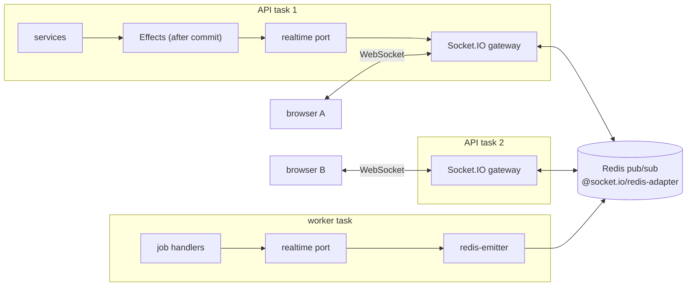

# Realtime

Euron Open Social pushes live updates (new DMs, chat messages, notifications, reaction
counts, presence) over Socket.IO. This page is the contract between the API and its
clients: the events, the rooms they travel through, who may join which room, what
delivery guarantees exist, and how the transport behaves behind the AWS edge.

The REST API stays the source of truth. A socket event is a hint that something changed;
a client that missed one recovers by reading the REST endpoint again. Related pages:
[HLD.md](HLD.md) (where the gateway sits), [LLD.md](LLD.md) (the Effects buffer and the
realtime port), [security.md](security.md), [threat-model.md](threat-model.md).

## 1. Moving parts

| Piece | File | Role |
| --- | --- | --- |
| Gateway | [`realtime/gateway.ts`](../../apps/api/src/realtime/gateway.ts) | The Socket.IO server inside every API task: handshake auth, rooms, subscribe checks, typing relays, presence, revalidation |
| Port | [`realtime/port.ts`](../../apps/api/src/realtime/port.ts) | `realtime.emit(rooms, event, payload)` and `realtime.disconnectUsers(...)`, plus the room name helpers. Services only ever call this |
| Worker emitter | [`realtime/emitter.ts`](../../apps/api/src/realtime/emitter.ts) | The port's transport in the worker process: `@socket.io/redis-emitter` |
| Presence | [`realtime/presence.ts`](../../apps/api/src/realtime/presence.ts) | Online state in Redis sorted sets |
| Effects | [`core/effects.ts`](../../apps/api/src/core/effects.ts) | Buffers emits during a transaction and flushes them after commit |
| Event types | [`packages/types/src/index.ts`](../../packages/types/src/index.ts) | `ServerToClientEvents`, `ClientToServerEvents`, `Ack` |
| Client | [`packages/api-client/src/socket.ts`](../../packages/api-client/src/socket.ts) | Typed client, token in `auth`, reconnect after a token refresh |

The port starts as a no-op. At boot the API installs the gateway as its transport
(`setRealtimeTransport` in `startGateway`), and the worker installs the Redis emitter
(`startEmitter`). Tests install a recorder or nothing. Services therefore never import
Socket.IO.

## 2. Connecting

- Path: `/socket.io`, same origin as the web app ([`gateway.ts`](../../apps/api/src/realtime/gateway.ts) sets `path: "/socket.io"`, `serveClient: false`).
- CORS for the polling transport: `allowedOrigins()` from [`core/config.ts`](../../apps/api/src/core/config.ts) (`CORS_ORIGINS`, else `APP_WEB_URL`).
- Authentication: the access token in `handshake.auth.token`. The gateway calls
  `actorFromToken` from [`middleware/auth.ts`](../../apps/api/src/middleware/auth.ts), the same function the HTTP
  middleware uses, so the user row is reloaded and `token_version` is compared. A refused
  handshake gets an `Error` whose message is the failure code: `MISSING`, `INVALID`,
  `BANNED`, `DEACTIVATED`, `TOO_MANY_CONNECTIONS` (the user already has 20 live sockets,
  `MAX_SOCKETS_PER_USER`, counted from the presence sets so the cap holds across tasks) or
  `INTERNAL` if the lookup throws.
- The socket remembers the actor and the token's `ver` claim in `socket.data`.

The refresh cookie plays no part in the socket: the handshake carries the in-memory access
token, so a cross-site page cannot open an authenticated socket with the victim's cookies.

### Client behaviour

[`createSocket`](../../packages/api-client/src/socket.ts) passes `auth` as a callback, so
each (re)connect reads the latest token. Transports are `["websocket", "polling"]`,
reconnection delay 1 s growing to 10 s, `withCredentials: true`. The server authenticates
only at handshake, so after a token refresh the client calls `reconnectWithFreshToken()`,
which disconnects and connects again when the token changed. The web app does this on
every refresh ([`apps/web/src/lib/realtime/provider.tsx`](../../apps/web/src/lib/realtime/provider.tsx)).

## 3. Rooms

Room names come from `rooms` in [`realtime/port.ts`](../../apps/api/src/realtime/port.ts). Clients never name a
room directly: they send a `*:subscribe` request and the server joins them after the same
check the matching REST read applies.

| Room | Joined | Rule checked on subscribe |
| --- | --- | --- |
| `user:<id>` | Automatically on connect | The authenticated user |
| `staff` | Automatically on connect for platform `MODERATOR` and `ADMIN` | `isStaff(actor)` |
| `chat:<communityId>` | `chat:subscribe` | `canUseChat` in [`services/chat.service.ts`](../../apps/api/src/services/chat.service.ts): community PUBLISHED and an ACTIVE membership |
| `community:<id>` | `community:subscribe` | Community PUBLISHED and `canReadCommunity` from [`repositories/visibility.ts`](../../apps/api/src/repositories/visibility.ts) (public, or ACTIVE member, or staff) |
| `post:<id>` | `post:subscribe` | Post PUBLISHED, `canReadCommunity` on its community, `notBlocked` against its author |
| `thread:<id>` | `thread:subscribe` | The user is an ACTIVE or REQUESTED participant. Nothing is broadcast to this room today (every DM event, typing included, goes to `user:<id>` rooms so every tab gets it); it marks the open thread and is revoked like the others |

Every subscribe validates the id shape (`isId`) and answers through the `Ack` callback:
`{ ok: true }`, or `{ ok: false, code, error }` with `VALIDATION_FAILED`, `NOT_A_MEMBER`
or `NOT_FOUND`, or `RATE_LIMITED` past 30 subscribe and presence requests per socket in 10
seconds (`REQUEST_LIMIT`, `REQUEST_WINDOW_MS`). A refusal never says whether the target
exists. Unsubscribes need no check.

Revocation: when access ends the server takes the user's sockets out of the room on every
task (`realtime.leaveRooms`, queued with `fx.leave` after commit; the gateway calls
`io.in(userRooms).socketsLeave(rooms)`, the worker's emitter the same). Leaving a community,
being removed, banned or suspended in it leaves `chat:<id>` and `community:<id>`; leaving a
group leaves `thread:<id>`; a block leaves the pair's 1:1 `thread:<id>`. `post:<id>` rooms
are left lazily (on unsubscribe or reconnect). Rooms do not survive a reconnect, so the web app re-sends its subscribes on every
`connect` (`useRoom` in [`provider.tsx`](../../apps/web/src/lib/realtime/provider.tsx)).

## 4. Event contract

### Server to client

Who emits each event and where. "After commit" means the emit is queued on an `Effects`
buffer (`fx.emit` or `fx.after`) or issued after `withTransaction` returned.

| Event | Payload | Room | Emitted by |
| --- | --- | --- | --- |
| `notification:new` | `Notification` | `user:<recipient>` | `notify()` in [`services/notification.service.ts`](../../apps/api/src/services/notification.service.ts), after commit |
| `notification:count` | `{ unread }` | `user:<recipient>` | `notify()` after commit; `markRead`, `markAllRead` |
| `dm:message` | `{ threadId, message }` | `user:<id>` of every ACTIVE or REQUESTED participant and the sender | `sendMessage` in [`services/dm.service.ts`](../../apps/api/src/services/dm.service.ts), after the transaction |
| `dm:message:updated` | `{ threadId, message }` | `user:<id>` of participants | DM edit, pin, react; restore by moderation ([`services/moderation/targets.ts`](../../apps/api/src/services/moderation/targets.ts)) |
| `dm:message:deleted` | `{ threadId, messageId }` | `user:<id>` of participants | DM delete; a moderation hide or remove |
| `dm:read` | `{ threadId, userId, lastReadAt }` | `user:<id>` of participants (including the reader's other tabs) | `markRead` in `dm.service.ts` |
| `dm:typing` | `{ threadId, userId, typing }` | `user:<id>` of the other participants, minus blocks | Gateway relay of the client's `dm:typing` |
| `dm:request` | `{ thread }` | `user:<recipient>` | First message of a direct request; group creation for invitees who do not follow the creator |
| `dm:thread:updated` | `{ thread }` | `user:<id>` | Group created, people added, someone leaves, request accepted, title changed |
| `chat:message` | `{ communityId, message }` | `chat:<communityId>` | `sendMessage` in `chat.service.ts`, after commit |
| `chat:message:updated` | `{ communityId, message }` | `chat:<communityId>` | Chat edit, pin, react; restore by moderation |
| `chat:message:deleted` | `{ communityId, messageId }` | `chat:<communityId>` | Chat delete (own or moderator); moderation hide or remove |
| `chat:typing` | `{ communityId, userId, displayName, typing }` | `chat:<communityId>` minus the sender's own sockets | Gateway relay |
| `feed:new-posts` | `{ communityId, count, latestId }` | `community:<id>` | `create` in [`services/post.service.ts`](../../apps/api/src/services/post.service.ts), only for posts created PUBLISHED |
| `post:updated` | `{ postId, reactionCount, reactionCounts, commentCount }` | `post:<id>` | Post reaction change ([`reaction.service.ts`](../../apps/api/src/services/reaction.service.ts)); comment created or removed ([`comment.service.ts`](../../apps/api/src/services/comment.service.ts)) |
| `post:removed` | `{ postId }` | `post:<id>` and `community:<communityId>` | Author delete or moderator removal in `post.service.ts`; moderation status change away from PUBLISHED |
| `post:comment` | `{ postId, comment }` | `post:<id>` | Comment created |
| `presence:update` | `{ userId, online, lastSeenAt }` | `user:<id>` of the presence audience | Gateway, when a user goes online or offline |
| `moderation:queue` | `{ openCases }` | `staff` | `emitQueue` in [`services/moderation/cases.service.ts`](../../apps/api/src/services/moderation/cases.service.ts) when a case opens or resolves |
| `session:revoked` | `{ reason: "SUSPENDED" \| "BANNED" \| "SIGNED_OUT" }` | `user:<id>`, then the sockets are disconnected | `disconnectUsers` (suspend, ban) and the revalidation timer |

Comment reactions update the comment's counts in the response but emit nothing.

Live `chat:message` events go to the whole room, including people who blocked the sender.
History reads (`GET /api/chat/:communityId/messages`) leave blocked senders out; the web
app is expected to drop live events from people in its block list
(`/api/users/me/blocks`). This is stated in the header of
[`chat.service.ts`](../../apps/api/src/services/chat.service.ts).

### Client to server

| Event | Payload | Ack | Handling |
| --- | --- | --- | --- |
| `chat:subscribe` / `chat:unsubscribe` | `{ communityId }` | subscribe only | See rooms |
| `community:subscribe` / `community:unsubscribe` | `{ communityId }` | subscribe only | See rooms |
| `post:subscribe` / `post:unsubscribe` | `{ postId }` | subscribe only | See rooms |
| `thread:subscribe` / `thread:unsubscribe` | `{ threadId }` | subscribe only | See rooms |
| `dm:typing` | `{ threadId, typing }` | none | Participant check, then relayed to the other participants' user rooms, minus blocks |
| `chat:typing` | `{ communityId, typing }` | none | Relayed only if this socket is already in `chat:<communityId>` |
| `presence:query` | `{ userIds }` | `Record<userId, boolean>` | Up to 100 valid ids. Only people the viewer could know about are answered (a shared ACTIVE membership of a published community, a follow either way, or a shared DM thread), minus blocks; the rest are omitted. Answered from Redis |

Handlers that do I/O are wrapped by `guarded(...)`: an exception is logged and, when the
client passed an ack, answered with `{ ok: false, code: "INTERNAL" }`.

### Typing throttle

Each socket keeps a map of the last "started typing" relay per target. A `typing: true`
within 2 s (`TYPING_THROTTLE_MS`) of the previous one for the same thread or room is
dropped; `typing: false` always goes through and clears the entry. `dm:typing` handlers
are chained per socket (`inOrder`), so a "stopped" event cannot overtake the "started"
event it follows.

## 5. Delivery guarantees

- **After commit.** Writes queue their emits on the `Effects` buffer; `flush()` runs only
  after `withTransaction` committed ([`core/effects.ts`](../../apps/api/src/core/effects.ts)). A rolled-back write never
  produces an event. A failing emit is logged and never fails the request.
- **At most once.** Socket.IO keeps no backlog. A client that is offline, reconnecting or
  not yet subscribed when the emit happens never sees it. There are no sequence numbers and
  no replay.
- **No cross-room ordering.** Events from one API task to one socket arrive in emit order;
  events from different tasks (or the worker) through Redis have no global order.
- **Recovery is a refetch.** After a reconnect, clients re-subscribe and reload what is on
  screen through REST (lists are keyset-paginated, so "newest page" is cheap). Unread
  badges have REST endpoints for this: `/api/notifications/unread-count`,
  `/api/dms/unread`, `/api/chat/unread`.
- **Payloads are views, not commands.** A `message` or `comment` in an event is built for
  one viewer (often the sender). Fields that depend on the viewer, such as reaction
  "by me" flags, may be wrong for other recipients; a refetch corrects them.

## 6. Fan-out across tasks

Every API task runs the gateway with `@socket.io/redis-adapter`
(`io.adapter(createAdapter(pub, sub))`, two dedicated Redis connections from
`newRedisClient()` in [`integrations/redis.ts`](../../apps/api/src/integrations/redis.ts)). An emit on any task is
published to Redis and delivered by whichever task holds the target sockets.

The worker has no Socket.IO server. [`realtime/emitter.ts`](../../apps/api/src/realtime/emitter.ts) installs a
transport built on `@socket.io/redis-emitter`, which publishes in the adapter's format, so
a job (for example a moderation scan that hides a chat message, or an event reminder
notification) reaches users on every API task. `disconnectUsers` works the same way
through `emitter.in(rooms).disconnectSockets(true)`.

On ElastiCache the parameter group caps the pub/sub output buffer of a slow subscriber
(hard 64 MB, soft 16 MB for 60 s) so a lagging adapter connection is dropped rather than
exhausting memory ([`modules/cache/main.tf`](../../infra/terraform/modules/cache/main.tf)).

## 7. Presence

Presence lives in Redis, one sorted set per user: `presence:<userId>`, members are socket
ids, scores are the last heartbeat in milliseconds ([`realtime/presence.ts`](../../apps/api/src/realtime/presence.ts)).

| Constant | Value | Meaning |
| --- | --- | --- |
| `HEARTBEAT_MS` | 30 s | Each API task refreshes the score of every socket it holds |
| `ONLINE_WINDOW_MS` | 90 s | A user is online while any member scored within this window |
| `KEY_TTL_SECONDS` | 120 s | Refreshed on every heartbeat, so abandoned keys expire |

1. On connect, `markOnline` counts live members, adds the socket, trims members older than
   the window and sets the TTL in one `MULTI`. If the count was zero, the user just came
   online and the gateway announces it.
2. Every 30 s, `heartbeat` re-adds every local socket with the current time.
3. On disconnect, `markOffline` removes the socket. If no live member remains, the gateway
   writes `users.last_seen_at` and announces offline with that time. The disconnect work
   waits for the connect bookkeeping of the same socket, so a quick connect and disconnect
   cannot leave a stale member.
4. A task that dies without cleaning up stops counting after 90 s, because its members stop
   being refreshed.

The announcement audience (`presenceAudience`) is the user's DM thread contacts (both
ACTIVE in a thread) plus their followers, at most 200 (`PRESENCE_FANOUT_CAP`), minus
anyone with a block either way. `presence:query` answers for up to 100 ids, only for people
the viewer could know about (see the event table).

## 8. Revalidation and forced disconnects

Every 5 minutes (`revalidateMs`, default `5 * 60_000`) each task re-reads the users behind
its sockets in one query and, per socket:

- user missing, `DEACTIVATED`, or `token_version` different from the handshake: emit
  `session:revoked { reason: "SIGNED_OUT" }` and disconnect;
- `BANNED`: `session:revoked { reason: "BANNED" }` and disconnect;
- otherwise refresh the cached status (an expired suspension counts as `ACTIVE`).

Account actions in [`services/moderation/actions.service.ts`](../../apps/api/src/services/moderation/actions.service.ts)
disconnect at once: SUSPEND queues `fx.disconnect([userId], "SUSPENDED")` and BAN
`fx.disconnect([userId], "BANNED")` (BAN also revokes sessions and bumps
`token_version`). Sign out everywhere, password change and reset, and account deletion
disconnect at once too (`SIGNED_OUT`, from `auth.service.ts` and `account.service.ts`). A
suspended account is still allowed to authenticate (it can read), so its
client may reconnect. The web app treats `SUSPENDED` as read-only: it stays signed in,
re-reads `GET /api/auth/me`, shows a persistent "restricted" banner, disables every composer
and reconnects the socket. `BANNED` and `SIGNED_OUT` sign the user out.

## 9. Behind the load balancer and CDN

| Setting | Value | Where | Why |
| --- | --- | --- | --- |
| ALB path rule | `/api/*`, `/socket.io/*`, `/up` to the API target group | [`modules/deployment/main.tf`](../../infra/terraform/modules/deployment/main.tf) | One origin for pages, API and socket |
| ALB idle timeout | 120 s (`alb_idle_timeout`) | [`modules/edge/main.tf`](../../infra/terraform/modules/edge/main.tf) | Above Socket.IO's 25 s ping interval, so a quiet WebSocket is not cut |
| Target group stickiness | `lb_cookie`, 86400 s, API only | [`modules/service/main.tf`](../../infra/terraform/modules/service/main.tf) | The HTTP long-polling fallback must reach the same task for every request until the upgrade |
| Deregistration delay | 60 s for the API | `modules/deployment/main.tf` | Sockets drain before a task is removed |
| CloudFront behaviors | `/api/*` and `/socket.io/*`: caching disabled, `Managed-AllViewer` origin request policy (all headers, cookies, query strings), HTTPS only | [`modules/cdn/main.tf`](../../infra/terraform/modules/cdn/main.tf) | CloudFront upgrades WebSockets on these behaviors without extra settings |
| CloudFront origin read timeout | 60 s, keep-alive 60 s | `modules/cdn/main.tf` | Long-polling holds a request open for up to the ping interval |
| Redis | TLS, AUTH token, `noeviction` | [`modules/cache/main.tf`](../../infra/terraform/modules/cache/main.tf) | Adapter, presence and queues share it |

Locally the browser connects to the web app on port 3510, whose Next.js rewrites proxy
`/socket.io` to the API ([`apps/web/next.config.ts`](../../apps/web/next.config.ts)). Troubleshooting for proxies that
drop WebSocket upgrades is in [troubleshooting.md](../guides/troubleshooting.md).

## 10. Testing

[`realtime.int.test.ts`](../../apps/api/test/integration/realtime.int.test.ts) runs the gateway in-process with
`listenWithGateway(createApp(), { revalidateMs })` (exported from `gateway.ts` for this)
and real `socket.io-client` connections. The client side is covered by
[`packages/api-client/test/socket.test.ts`](../../packages/api-client/test/socket.test.ts). See [testing.md](../guides/testing.md).

## 11. Known gaps

Stated as the code behaves today; the full list is in [security.md](security.md#known-limitations).

- **`post:<id>` rooms are left lazily.** Revocation covers `chat:`, `community:` and
  `thread:` rooms; a socket already in a post's room keeps its counts and new comments
  until it unsubscribes or reconnects. Revalidation re-reads only the account.
- **The connection cap is approximate.** It counts presence entries, so a dead task's
  sockets count for up to 90 seconds and simultaneous handshakes can briefly pass 20. The
  per-socket request budget is in memory and per socket.
