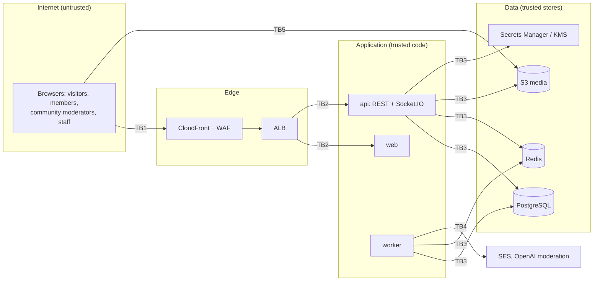

# Threat model

A STRIDE analysis of Euron Open Social as deployed by the Terraform in `infra/terraform`
(an aws-prod shaped environment, CloudFront and WAF enabled) with the defaults in the code.
Each row names the threat, the control that exists today and what remains. The controls are
described in [security.md](security.md); the gaps it lists under
[Known limitations](security.md#known-limitations) appear here with a rating.

Residual risk is stated plainly. **Accepted** means a design choice; **open** means a known
gap that should be fixed; the rating (low, medium, high) is the impact on a typical network
if exploited.

## Scope and trust boundaries

| Boundary | Crossing |
| --- | --- |
| TB1 | Public internet to the edge: every request and every socket frame is untrusted |
| TB2 | Edge to tasks: TLS ends at the ALB; tasks are in private subnets |
| TB3 | Application to its stores: IAM task roles, security groups, TLS to RDS and Redis |
| TB4 | Application to third parties: SES always; OpenAI when the provider is `openai` (content text and signed image URLs leave the deployment) |
| TB5 | Browser straight to S3 with presigned URLs: the only data path that skips the API |

## Assets

| Rank | Asset | Why it matters |
| --- | --- | --- |
| 1 | `JWT_SECRET` | Whoever holds it can mint an access token for any account, including admins |
| 2 | Admin and staff accounts | Ban anyone, read every private community and every DM case, change moderation settings |
| 3 | Direct messages and private community content | The most private user data |
| 4 | Refresh tokens and sessions | Long-lived (30 days) access to an account |
| 5 | Uploaded media, including any metadata | Photos can carry location |
| 6 | Account data: emails, profiles, follow and block graphs, IPs in `sessions` and `audit_log` | Personal data |
| 7 | Moderation integrity: cases, actions, appeals, the audit log | Trust in the network; accountability of moderators |
| 8 | Terraform state | Holds the generated application secrets and the Redis AUTH token |
| 9 | Availability of the API, sockets and the job queue | The product |
| 10 | SES reputation of the sending domain | Mail delivery for everyone |

## Spoofing

| Threat | Mitigation | Residual |
| --- | --- | --- |
| Password guessing | bcrypt cost 12, policy of 10+ characters, failure budgets in Redis (5 per account and IP per 15 minutes, 50 per account per hour across IPs), `auth` limiter of 10 per minute per IP, WAF rate limit | Distributed guessing stays under 50 attempts per account per hour. Accepted, low |
| Account enumeration | Dummy bcrypt compare for unknown accounts, identical `INVALID_CREDENTIALS`, `202` for forgot-password and resend; throttled sign-ins get the same `429 RATE_LIMITED` whether or not the account exists (unknown logins have their own budget) | `USERNAME_TAKEN` / `EMAIL_TAKEN` on sign-up confirm that an account exists. Accepted, low |
| Sign-in throttling as denial of service | No lock: the per-IP budget only slows one source, and the owner can still sign in from another network | Someone spending the account-wide budget (50 failures per hour from many IPs) keeps the owner out for up to an hour. Accepted, low |
| Stolen access token | 15 minute lifetime, memory only (not readable by other origins or from storage), user and `token_version` reloaded on every request | An XSS in the web app could use the token for its lifetime. The nonce CSP with `strict-dynamic` lowers that risk. Accepted, medium |
| Stolen refresh token | `httpOnly`, `Secure`, `SameSite=Lax`, path `/api/auth`, hashed at rest, rotated on every use, reuse after 10 s revokes the family | A thief who refreshes first holds the session until the victim's next refresh triggers reuse detection. Accepted, low |
| Forged access token | HS256 with a 64-character generated secret; algorithm, audience and issuer pinned; boot refuses default, short or shared secrets | Holders of `JWT_SECRET` can mint any session (rank 1). Protect Secrets Manager and Terraform state. Accepted |
| TOTP brute force or replay | 6 digits, one step of drift, failures count toward the sign-in budgets, each time step usable once; secrets encrypted at rest (AES-256-GCM, key from `TOTP_ENCRYPTION_KEY`, bound to the user id); disabling needs the password and a current code; ten single-use recovery codes stored as HMACs | A database read together with `TOTP_ENCRYPTION_KEY` still exposes the second factors; the key has no rotation path. Accepted, low |
| Signed-out access after sign-out | `logout` revokes the refresh family; "sign out everywhere", password change and reset bump `token_version` and disconnect every socket at once | After a plain `logout` the current access token stays valid for up to 15 minutes. Accepted, low |
| Admin bootstrap password exposure | `admin:create` emails a set-password link; on AWS the admin task has the api's mail settings and an SES send permission scoped to the deployment's identity and configuration set, so no password reaches the task log | Whoever reads the admin's mailbox can take the account until the link expires. Accepted, low |
| Socket impersonation | Handshake authenticated with the same function as HTTP; rooms are server-assigned; subscriptions checked with the REST rules | None identified for authentication. Room revocation gaps are under information disclosure |
| Spoofed mail from the network's domain | SES identity with DKIM, custom MAIL FROM for SPF alignment, DMARC record created with policy `none` by default | Tightening DMARC to `quarantine` or `reject` is the domain owner's decision (`dmarc_policy`). Accepted |

## Tampering

| Threat | Mitigation | Residual |
| --- | --- | --- |
| SQL injection | Kysely with bound parameters everywhere; raw fragments bind values; search text reduced to word characters before `to_tsquery`; `ILIKE` input escaped | None identified |
| Mass assignment and invalid input | zod schemas per endpoint, strict admin settings schema, length CHECKs in the schema | None identified |
| Editing or deleting someone else's content | Author checks in every edit path; moderator powers from `computeAccess()` with rank checks for member actions; case actions and appeal decisions refuse cases about the actor's own content or account (`SELF_MODERATION`, platform admins excepted) | Case actions have no rank check: a community moderator can act on content by a higher-ranked member. Open, low |
| Malicious file content (stored XSS through uploads) | Allowlist; SVG, HTML, XML and scripts refused; extension must match; magic bytes and a markup check on the stored object; presigned PUT signs the content type; documents served as attachments; private bucket on its own origin | Polyglot files that pass a magic-number check are still possible, but they are served from the S3 origin with a fixed content type, never the app origin. Accepted, low |
| Attaching someone else's upload | Uploads are referenced by id only; owner, purpose, status and single use are checked inside the transaction | None identified |
| Counter manipulation through races | Parent rows locked for reactions, votes, RSVPs and DM sends; unique constraints for once-only rows; reconciliation every 6 hours | None identified |
| Message-request spam beyond the cap | 3 messages while pending, counted including deleted ones, refused afterwards; the `DM_REQUEST` notification fires once | None identified |
| Report brigading | One report per person per target; only reports on the target's current OPEN case count, from reporters who are ACTIVE with accounts older than a day; three needed; never accounts, communities or staff content | A coordinated group of three established accounts can still hide content pending review. Accepted, low |
| Appeal reversal side effects | A different staff member decides; admins self-decide only with a note; an overturned SUSPEND or BAN restores `ACTIVE` only while the account is still in that state and no later moderation action exists, otherwise the overturn is recorded without changing the account | None identified |
| Tampered migrations | Applied files are checksummed; a changed file stops the runner | Anyone who can push an image can ship a new migration. Process control, accepted |
| Supply chain | Frozen lockfile installs, pinned base images, immutable ECR tags with scan on push, `pnpm audit` and CodeQL in the opt-in pipeline | No image signing or provenance verification. Open, low |
| Direct database modification | Private subnets, TLS enforced, credentials only in Secrets Manager, per-consumer security groups; an optional least-privilege application role (data rights only) for the api and worker, created by the operator after deploy ([operations.md](../guides/operations.md#least-privilege-database-role)) | Until that manual step is done, the API connects as the RDS master user, so a compromised task has full DDL and DML rights. Open, medium (low with the role) |

## Repudiation

| Threat | Mitigation | Residual |
| --- | --- | --- |
| A moderator or admin denies an action | `moderation_actions` records every case action, automated hide and moderator removal through the ordinary delete endpoints (`REMOVE`, no case) with the actor (null for automation); `audit_log` records sign-ins, password and TOTP changes, role, account and settings changes, community administration and moderator removals, in the same transaction as the change | None identified |
| A user denies sending a message | Messages are stored with the sender; edits keep `edited_at`; deletes are tombstones (`DELETED`), not row deletions | Edit history (previous bodies) is not kept, except the case snapshot when a case exists. Accepted |
| Disputed automated decisions | The case stores the provider name, the scores and categories, and a snapshot of the content as it was | None identified |

## Information disclosure

| Threat | Mitigation | Residual |
| --- | --- | --- |
| Reading a private community as a non-member | `canReadCommunity()` in every list, `computeAccess().canRead` in every single read, 404 for hidden content, limited community card; leaving, removal, a ban or a suspension takes the user's sockets out of the community's `chat:` and `community:` rooms at once | `post:` rooms are left lazily, so live counts and new comments on a post page already open can keep arriving until the page is closed. Accepted, low |
| Reading someone else's DMs | Participant check on every thread call (404 otherwise); DM events go only to participants' `user:` rooms; DM cases visible to platform staff only; people added to a group see only messages from their `joined_at` on | Staff can read DM content that reaches a case (by design, for reports). Accepted, low |
| Content from people you blocked | `notBlocked()` both ways in every read, notification, mention and presence path | Live chat events in a shared room reach blocked users and are filtered by the client; blocks do not apply to signed-out viewing of public content. Accepted, low |
| Presence tracking | Presence announcements go to followers and DM contacts minus blocks; `presence:query` answers only for people sharing an ACTIVE community, a follow either way or a DM thread with the viewer, minus blocks | Anyone who joins a large public community can watch its members' online status. Accepted, low |
| Location leaks through photos | Images re-encoded without metadata, and shown to nobody but the uploader until that has happened (`READY`); HEIC the server cannot decode is rejected | Video, audio and documents keep their metadata. Open, low |
| Long-lived media links | GET URLs expire after 15 minutes; the bucket is private | A URL keeps working until it expires even after a block, a removal or a membership change. Accepted, low |
| Content in email | Digest lines are escaped, at most 10, 80 characters of snippet; DM requests and private-community activity use generic text with no snippet or name; users can turn digests off (`emailDigest`) | None identified |
| Content sent to the moderation provider | Only with `openai`; images as short-lived signed URLs | The provider receives post, comment, chat, DM, question, answer and event text. Disclose this in the network's privacy notice. Accepted |
| Error and log leaks | 500s carry only a request id; secret fields and auth headers redacted at the top level and up to three levels deep; signed media tokens masked in access logs | A secret nested deeper than three levels, or under an unlisted field name, is not masked. Accepted, low |
| Secrets exposure | Secrets Manager injection, KMS encryption, no secrets in task definitions | Terraform state holds the generated secrets; the OpenAI key too when passed as a variable (it can be put in by hand instead). Accepted, protect the state backend |

## Denial of service

| Threat | Mitigation | Residual |
| --- | --- | --- |
| Request floods | WAF per-IP limit (2000 per 5 minutes), per-route Redis limiters, 1 MB body cap, autoscaling | None beyond capacity limits. Accepted |
| Socket floods | Typing throttled per socket; presence fan-out and queries capped (200, 100); 30 subscribe or presence requests per socket per 10 seconds (`RATE_LIMITED`); at most 20 live sockets per user (`TOO_MANY_CONNECTIONS`) | The connection cap is counted from presence, so a burst of simultaneous connections can briefly exceed it. Accepted, low |
| Redis outage | Multi-AZ replica with failover in prod; `noeviction`; rate limiters fall back to in-memory insurance limiters | During the outage limits are per task (the budget multiplies by the task count); jobs cannot be enqueued; cross-task fan-out stops. Accepted, medium |
| Expensive feeds and search | Keyset pagination with matching indexes, limits capped at 50, search on trigram and tsvector indexes only, `search` limiter | Ranked feeds compute scores over a community's published posts per page; very large communities may need a materialised score. Accepted, low |
| Large uploads | Per-kind size limits signed into the PUT; uploads never pass through the API (except `STORAGE=local`) | Processing reads a whole image into memory (at most 15 MB) and video or audio up to 100 MB for durations. Accepted, low |
| Moderation provider outage | Timeouts and retries; content stays visible and `UNCHECKED`; premoderated posts get their case at creation, independent of the scan; `openai` with no real key falls back to `rules` | During an outage nothing is auto-hidden. Accepted |
| Job queue starvation | Separate queues; moderation concurrency 8, others 4 per worker; failed jobs kept for inspection; a `worker-failed-jobs` alarm (log metric filter, more than 5 failed attempts in 5 minutes) | No queue-depth or job-age alarm, so a worker that is down rather than failing is seen only through missing side effects. Open, low |

## Elevation of privilege

| Threat | Mitigation | Residual |
| --- | --- | --- |
| A member gains moderator powers | Roles change only through `setRole` (OWNER/ADMIN, rank-checked, ADMIN appointed only by the OWNER or a platform admin); only an `ACTIVE` membership confers powers | None identified |
| A suspended or banned community moderator keeps powers | `computeAccess()` requires an `ACTIVE` membership and an `ACTIVE` account for every moderation flag; the moderation desk (`actOnCase`, `decideAppeal`) requires an ACTIVE account | None identified |
| A staff moderator acts on admins or other staff | `applyAccountAction` refuses admins entirely and moderators unless the actor is an admin; nobody acts on their own account | None identified |
| Removing the last admin | `changeRole` locks every active admin row and refuses to demote the last one; nobody changes their own role | None identified |
| Self-approval of moderated content | Reporters cannot report their own content; case actions and appeal decisions about one's own content or account are refused (`SELF_MODERATION`) except for platform admins | An admin can still act on their own case (on the record). Accepted, low |
| Escaping the container or the role | Read-only root filesystem, non-root user, no ECS Exec, task roles limited to the media bucket, one SES identity and the DB secret | None identified |
| Bypassing the WAF | With the CDN on, the ALB accepts only CloudFront origin-facing ranges, and its rules forward only requests carrying a generated secret header (`X-Origin-Verify`) that this deployment's distribution adds; everything else gets 403 | The header value is a static secret in Terraform state and the CloudFront configuration; rotation is a manual `terraform apply -replace`. Accepted, low |

## Highest residual risks

1. Until the least-privilege database role is created, the API connects as the RDS master user.
2. Case actions have no rank check within a community.
3. Video, audio and documents keep their metadata.
4. Signed media URLs outlive permission changes for up to 15 minutes.
5. The account-wide sign-in budget can be spent by others to keep an owner out for an hour.

Fixed in the hardening pass (previously on this list): room revocation on leave, removal, ban,
suspension, group leave and block; author and account-status checks on case actions; scoped
`presence:query`; images hidden until their metadata is stripped; report counting per open
case and status-aware appeal overturns; encrypted TOTP secrets with recovery codes, and
throttling instead of lockout.
